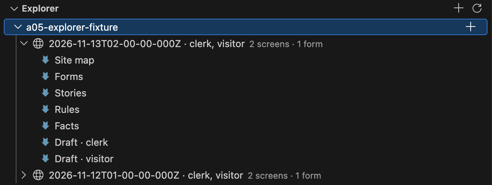

# Explore an application

This guide runs the **Explorer**, the part of the [Analyst](index.md) that visits a running web application by itself. It signs in as each role that you name, clicks through the links, menus and buttons, and writes what it found. No person drives, and no model is called.

**In short**
- You run [`codelead analyst explore`](reference/analyst-explore.md) with the application's address, as a visitor, as given accounts, or with Windows sign-in.
- **Observe only** is the default: the Explorer sends no form. **Try forms** also sends each form with made-up values, and never a password.
- The Explorer stops each role at 200 screens, or 8 moves from the first page. You can change both limits.
- It writes a site map, the forms, the stories, and one recording and one draft for each role.



## Before you begin

- **The application runs**, and you know its address. For the Basic Store sample, this is `http://localhost:5080/`. CodeLead can start it for you in the modernization program. See [Start the old application for CodeLead](../modernization/source-run-profile.md).
- **CodeLead is installed with Playwright's Chromium**, the browser that the Explorer drives. [`codelead setup`](../cli/codelead-setup.md) installs it. See [Install CodeLead](../get-started/install.md).
- **The folder has the pro plan.** See [Licence and plans](../concepts/licence-and-plans.md).
- **You use a copy of the application, if you can.** The Explorer clicks buttons outside forms, and some buttons write data. See [Choose the safety layer](#choose-the-safety-layer).

> [!NOTE]
> **New to this?** The Explorer is useful when nobody can tell you which screens an application has. In a few minutes, it lists every screen that it can reach, every form, and which role can reach what.

## Choose how the users sign in

The Explorer explores once for each **role** (a kind of user, such as a clerk), because each role sees different screens. Choose one of three ways:

| Way | Option | What the Explorer does |
|---|---|---|
| A visitor | None (the default) | Explores as one anonymous visitor, the role `visitor`. It sees only what is public. |
| Given accounts | `--given-accounts` and one `--as <ROLE>=<ACCOUNT>` for each role | Signs in as each account through the application's sign-in form, then explores. |
| Windows sign-in | `--integrated <ACCOUNT>` | The browser answers the application's challenge by itself, as one account. There is one role, `alpha`. |

With given accounts, set each role's password before you start. The Explorer reads it from `CODELEAD_WALK_PASSWORD_<ROLE>`, the role in capitals. Without that variable, it reads the credentials file that `CODELEAD_WALK_CREDENTIALS` names. It never writes or prints a password. For the roles `clerk` and `admin`, set `CODELEAD_WALK_PASSWORD_CLERK` and `CODELEAD_WALK_PASSWORD_ADMIN`. See [Passwords](passwords.md).

A role's name starts with a letter (A to Z, a to z), then letters, digits or underscores, such as `clerk` or `night_shift`.

Where the Explorer signs in:

1. It looks on the first page for a sign-in form: a password field, with a field for the user name beside it.
2. When the first page has none, it clicks the first link or button whose words say that it signs in. The words are **Log in**, **Login**, **Sign in**, **Signin**, **Iniciar sesión**, **Anmelden** and **Connexion**. Then it looks for the form on that page. It makes one such move, and no other guess.
3. When neither works, give the sign-in page itself as the address, for example `--base http://localhost:5080/Account/Login`.

The crawl always starts from the first page, signed in.

## Choose the safety layer

| Layer | Option | What the Explorer sends |
|---|---|---|
| **Observe only** | None (the default) | No form. It clicks the links, the menu items and the buttons that are not part of a form. |
| **Try forms** | `--try-forms` | After the crawl, each form twice: once empty, then once with made-up values. |

**Observe only** never sends a form, and it never clicks a control whose words say that it signs out, logs out, deletes or removes. It does click every other button outside a form. A button such as **Archive** or **Approve** that writes with a script is clicked like any other.

> [!IMPORTANT]
> Explore a copy of the application, or explore as accounts whose clicks do not matter. Observe only sends no form, but a button outside a form can still change data.

**Try forms** reads the application's validations. It sends each form empty first, to see what the application refuses. Then it sends the form with these values:

| Field | Value |
|---|---|
| Text | `Explorer <its label>`, for example `Explorer Name` |
| E-mail | `explorer@example.com` |
| Number | `1` |
| Date | Today, for example `2026-11-20` |
| Time | `12:00` |
| Telephone | `5550100` |
| Address of a web page | `https://example.com/` |
| Drop-down | Its first option that has a value |
| Box to tick, radio button, file, password | Left as it is |

Try forms never sends a form with a password field, or a form with no visible button. It never sends a form whose button deletes, removes or signs out. It never types a password, except the role's own into the sign-in form.

> [!WARNING]
> Use **Try forms** only on a copy of the application that can receive test data. The forms write what they write: the made-up products, clients and orders stay in the application.

## Set the limits

- **`--max-screens <N>`** stops a role after N screens. The default is 200.
- **`--max-depth <N>`** stops the crawl N moves from the first page. A move is a click or the sign-in. The default is 8.

The Explorer also visits at most three addresses of one pattern that names a record, such as `/Products/Details/{id}`. It does not open every product. When a limit stops a role, the site map lists every control that the limit left, with the screen that it is on.

## Run the Explorer

1. Open a terminal in your project folder.
2. Set the passwords, if you explore as given accounts.
3. Run the Explorer. To explore the Basic Store sample as a visitor:

   ```console
   codelead analyst explore --base http://localhost:5080/
   ```

   The Explorer prints one line for each screen, then what it wrote:

   <!-- described, not captured -->
   ```output
   visitor: s01 reached / (Dashboard).
   visitor: s02 reached /Clients (Clients) by the link "Clients".
   visitor: s03 reached /Products (Products) by the link "Products".
   visitor: s04 reached /Orders (Orders) by the link "Orders".
   …
   visitor: … screens (0 refused), 0 not visited, … never followed; recording in explore-visitor/recording.json.
   Explored as visitor into analyst-recordings/2026-11-20T09-15-00Z: analyst-recordings/2026-11-20T09-15-00Z/explore-visitor/recording.json.
   Written: sitemap.json and sitemap.md, forms.json and forms.md, stories.json and stories.md, rules.observed.json and rules.observed.md, facts.observed.json and facts.observed.md.
   visitor's draft: analyst-recordings/2026-11-20T09-15-00Z/explore-visitor/journeys.json and journeys.md; no problems, CodeLead can walk it.
   ```

To explore as two given accounts, behind the **Log in** link, set both passwords first:

```console
export CODELEAD_WALK_PASSWORD_CLERK='<CLERK_PASSWORD>'
export CODELEAD_WALK_PASSWORD_ADMIN='<ADMIN_PASSWORD>'
codelead analyst explore --base http://localhost:5080/ --given-accounts --as clerk=store.clerk --as admin=store.admin
```

The first line of each role says where it signed in:

<!-- described, not captured -->
```output
clerk: s01 signed in on /Account/Login, reached from / through "Log in".
clerk: s01 reached / (Dashboard) by the sign-in.
…
admin: s01 signed in on /Account/Login, reached from / through "Log in".
…
```

> [!TIP]
> **For experienced users:** on PowerShell, set a variable with `$env:CODELEAD_WALK_PASSWORD_CLERK = '<CLERK_PASSWORD>'`. In VS Code, the Settings page keeps the passwords in the project's `.env` file, and `codelead analyst` reads that file. See [Passwords](passwords.md).

## Explore from VS Code

In the [Explorer view](../extension/explorer-view.md), select **+** (**Explore an application**). It asks four questions: the address, how users sign in, the safety layer and the number of screens. Then it runs the same command, and opens the new site map when the Explorer ends.

## Read what the Explorer wrote

Everything goes into one folder, `analyst-recordings/<time>/`, or the folder that `--out` names:

| File | What it holds |
|---|---|
| `sitemap.md`, `sitemap.json` | Every screen, the roles that reached it or were refused, the shortest way to it, its forms, and where its controls lead. |
| `forms.md`, `forms.json` | Every form with its fields, its button, its method and its address. With Try forms, each try and what the application answered. |
| `stories.md`, `stories.json` | For each role and screen, what the role can see and can do, as user stories. A refused screen is a "cannot reach" line. |
| `explore-<role>/recording.json` | The role's recording, one step for each new screen. |
| `explore-<role>/journeys.json` | The role's draft, already checked. |
| `rules.observed.md`, `facts.observed.md` | The rules and the facts of all the roles' recordings. |

Here is one screen of `sitemap.md`. In this application, only an administrator may open the page **Manage**, so the clerk was refused:

<!-- described, not captured -->
```markdown
### `/Manage` (Manage)

- Reached by: admin (`explore-admin/recording.json:s08`)
- Refused to: clerk, answered 403, the page showing "Not allowed" (`explore-clerk/recording.json:s08`)
- Way from the first page (as admin): sign in → the link "Manage"
- Leads to: the link "Products" → `/Products` (Products)
```

The same refusal is an `access` rule under `/Manage` in `rules.observed.md`, and a refusal of `/Manage` to clerk in `facts.observed.md`. See [`codelead analyst rules`](reference/analyst-rules.md).

See [Files the Analyst writes](files.md) for every file and its format.

## When the Explorer stops

| What you see | Why | What to do |
|---|---|---|
| `The explorer signs in as each account with its password, read from CODELEAD_WALK_PASSWORD_<ROLE> …, and has none for these: …` | A password is missing. Nothing opened, and nothing was written. Exit code 2. | Set each variable that the message names, or name a credentials file outside the folder. Then explore again. |
| `--as 1clerk=store.clerk: a role's name starts with a letter (A to Z), then letters, digits or underscores, …` | A role's name breaks the rule. Exit code 2. | Rename the role, for example `clerk1`. |
| `no sign-in form on / and no Log in link: give the sign-in page as the base address (--base <url>), or explore as a visitor (no --as)` | The Explorer found no sign-in form. The role explores nothing. | Give the sign-in page as `--base`, or explore as a visitor. |
| `… the sign-in as … was not accepted (the application refused the sign-in): nothing more was explored.` | The application refused the account or its password. | Check the account and its password variable. |
| `--max-screens 200 was reached`, in the site map's **Not visited** | A limit stopped the role. | Raise `--max-screens` or `--max-depth`, or accept the partial map. |
| `Playwright's Chromium is not installed here: run npx playwright install chromium, then explore again.` | The browser is missing. Exit code 1. | Install it, or run `codelead setup`. |

See [Messages and what to do](../reference/messages.md).

## Check that it worked

- The last lines say `Explored as …`, `Written: …`, and for each role `no problems, CodeLead can walk it`.
- The exit code is 0.
- `sitemap.md` lists the screens that you expected. Its **Not visited** section is empty, or it names a limit.
- In VS Code, the Explorer view lists the new exploration, labelled by its time and its roles.

Next, record the journeys that matter, with what each step must show. See [Record a journey](record-a-journey.md).

## Details

- **What the crawl never follows**: an address of another origin, the links `mailto:`, `tel:` and `javascript:`, and a link that opens another window. It also never follows a download, or a control with no name. The walk clicks by name, so a control with no name cannot be replayed.
- **What a screen is**: an address and its headings. One address in two states, such as a panel that opens, is two screens. The path is read without regard to case, so `/Products/Index` and `/products/index` are one screen.
- **Toggles**: the Explorer clicks each control that opens a menu, a panel or a tab, and reads what appears. It goes one level deep.
- **Queries**: the Explorer drops the query part of addresses unless you give `--keep-query`. With it, `/Products?active=true` is another screen than `/Products`.
- **`--no-derive`** writes the recordings, the site map, the forms and the stories only. You can make the drafts, the rules and the facts later with [`draft`](reference/analyst-draft.md), [`rules`](reference/analyst-rules.md) and [`facts`](reference/analyst-facts.md).
- **The same result each time**: the Explorer calls no model. The site map, the forms and the stories hold no time, and their order is fixed.
- **In the modernization program**: the Read stage runs the Explorer when the program has the application's address. Then [`codelead rebuild init`](../cli/codelead-rebuild-init.md) turns each story into a journey of the rebuild. See [The eight stages](../modernization/the-eight-stages.md).
- **Given accounts in the program**: `codelead modernize start --as clerk=store.clerk` (or `/modernize --run --as …` in the chat) keeps each role and its account in the program's state file. Every run of the Read stage then explores with `--given-accounts --as <role>=<account>`. The passwords come from the same places as above. A missing password makes the stage wait, and its problem names the variable. See [`codelead modernize start`](../cli/codelead-modernize-start.md#sign-in-accounts-for-the-crawl).
- **In spec-based validation**: [`codelead spec coverage`](../cli/codelead-spec.md) runs the Explorer in Observe only, then says which screens and forms no spec names.

## See also

- [`codelead analyst explore`](reference/analyst-explore.md)
- [The Explorer view](../extension/explorer-view.md)
- [Record a journey](record-a-journey.md)
- [Passwords](passwords.md)
- [Files the Analyst writes](files.md)
- [Limits](limits.md)
- [The dossier](../modernization/dossier.md)
