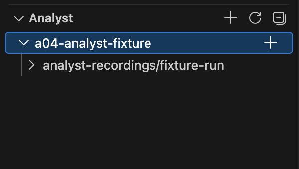

# Record a journey

This guide records the journeys that matter in a running application. You use the application in a browser. The [Analyst](index.md) cuts each journey into steps, and writes what it saw after every step. Later, CodeLead turns the recording into a specification that it can replay.

**In short**
- You start [`codelead analyst record`](reference/analyst-record.md), fill the setup in the **control window**, and select **Start session**.
- You start a **role**, then name each **journey** and use the application. The recorder cuts the steps by itself.
- **Expect this** marks what the page must show. **Alt+Shift+S** starts and ends a journey from the application's window.
- The recording keeps the actions, the requests and a screenshot of each step. It never keeps a password.

## Before you begin

- **The application runs**, and you know its address. For the Basic Store sample, this is `http://localhost:5080/`.
- **CodeLead is installed with Playwright's Chromium**, and the folder has the pro plan. See [Install CodeLead](../get-started/install.md) and [Licence and plans](../concepts/licence-and-plans.md).
- **You know the application**, or someone who knows it sits with you. A recording is only as good as the journeys that you choose.
- **You use test data.** The recording keeps the values that you type into ordinary fields, such as a product's name. Do not record real customers' data.

> [!NOTE]
> **New to this?** Record the tasks that people really do, and the refusals that matter. Five to ten journeys are usually enough to start. The [Explorer](explore-an-application.md) covers the screens that nobody records.

## Start a recording

1. Open a terminal in your project folder.
2. Start the recorder:

   ```console
   codelead analyst record
   ```

   A small **control window** opens. It drives the whole session. It is a browser of its own, so nothing that you do in it is recorded.

   <!-- screenshot wanted: the control window's setup, with Application address, Application name, the sign-in choices and Start session, on the Basic Store sample -->

3. Fill the setup:
   - **Application address**: `http://localhost:5080/`.
   - **Application name**: what you call it, for example `Basic Store`. It is optional.
   - **How it signs its users in**: choose **Its own sign-in form** for most applications. Also tick **Its users exist already** when the accounts are made elsewhere, for example in a directory. Choose **Windows sign-in** for Windows authentication. See [Choose the sign-in mode](#choose-the-sign-in-mode).
4. Select **Start session**. It checks your answers and says the first one that is wrong. It refuses an address that does not answer within 5 seconds.

Nothing is recorded, and no window of the application opens, before **Start session**.

The terminal prints the control window's address and the sign-in mode:

<!-- described, not captured -->
```output
The control window's page: http://127.0.0.1:53237/2MlrZ2…/ (served on this machine alone; its address holds its key).
Form sign-in: each role signs in through the application's own pages, in a window of its own with its own cookies.
```

> [!TIP]
> **For experienced users:** options fill the setup in advance. When they say everything, the session starts at once: `codelead analyst record --base http://localhost:5080/ --app "Basic Store" --sign-in form`.

From VS Code, select **+** (**Record a journey**) in the [Analyst view](../extension/analyst-view.md). It asks the address, the name and how users sign in, then starts the same command in a terminal.



## Start a role

A **role** is a kind of user, such as a clerk. Each role acts in a browser window of its own, with its own cookies.

1. Type the role's key in **Role**, for example `clerk`. A key starts with a letter (A to Z, a to z), then letters, digits or underscores.
2. Select **Start role**. A Chromium window opens at the application's address. Its title begins with the role's name, so that you can tell the windows apart.
3. If the role has an account, sign in in that window.

To act as another role, type its key and select **Switch role**. **Finish role** closes the role's window and keeps its steps.

## Record a journey

1. Type the journey's name in **Journey**, for example `create a product`.
2. Select **Start journey**. When the role's window is on another page, the recorder takes it to the first page first, because every replay starts there.
3. Use the application in the role's window. For the Basic Store sample: select **New product**, fill **SKU**, **Name** and **Unit price**, and select **Create product**.
4. Mark what must be true. Select **Expect this**, then click the text on the page, such as the message `Product "Desk lamp" was created.` Shift-click takes a whole row of a table. Escape cancels.
5. Select **End journey**.

The terminal says each step as the recorder cuts it:

<!-- described, not captured -->
```output
Journey "create a product" started (clerk): use the application in clerk's window, and the recorder cuts the journey into steps as it goes.
s01 cut (the page went to another address): / → /Products/Create, 2 actions, 0 requests: New product on /.
s02 cut (a form was sent): /Products/Create → /Products/Details/7, 5 actions, 1 request: Create product on /Products/Create.
Journey "create a product" ended: 2 steps (s01 to s02).
```

The recorder cuts a step at four points. The page goes to another address, a write is sent and answered, a dialog opens or closes, or a form is sent. You do not mark steps. See [Roles, journeys and steps](concepts.md#journeys-and-steps).

Repeat for each journey. Here are journeys that suit the Basic Store sample:

| Journey | What you do | Expect this |
|---|---|---|
| create a product | **New product**, fill SKU, name and price, **Create product** | The message that the product was created |
| refuse a duplicate SKU | **New product**, a SKU that exists, **Create product** | `Another product already uses this SKU.` |
| refuse an empty order | **New order**, a client and no lines, save | The message about at least one line |
| cancel an order | An order, **Edit**, the status Cancelled, save | `Cancelled` on the order's page |

**Pause** stops the recording for a while. Nothing that you do while paused is recorded. **Resume** continues.

### Use the keys, the bar or the terminal

The control window is the quickest way. You can also drive the session from these places, and each one shows what the others did:

- **The keys**, in a role's window: **Alt+Shift+S** (**Option+Shift+S** on a Mac) starts a journey when none is open, and ends the open one. **Alt+Shift+E** is **Expect this**. The page never sees these keys.
- **The bar**: with `--bar`, each role's window shows a bar along its bottom edge, with **Role**, **Journey** and **Finish session**. The bar is off by default. It is never recorded, and it is hidden in every screenshot.
- **The terminal**: `role clerk` starts or switches a role. A line that is not a command starts a journey with that name. An empty line ends the journey. `pause`, `resume` and `expect` do what their names say. `finish` ends the session.

<!-- screenshot wanted: a role's window with the bar along its bottom edge (record --bar), on the Basic Store sample -->

## Choose the sign-in mode

| Mode | Setup choice | Option | Roles |
|---|---|---|---|
| The application's own sign-in pages | **Its own sign-in form** | `--sign-in form` | Many, each in its own window |
| The same, with accounts that exist | **Its own sign-in form** and **Its users exist already** | `--given-accounts` | Many |
| Windows authentication | **Windows sign-in** | `--sign-in windows` or `--integrated <ACCOUNT>` | One |

With the application's own sign-in pages, you type the password in the role's window as usual. The recorder masks it. You do not need a password variable.

### Windows integrated sign-in

An application behind Windows authentication has no sign-in form. The browser signs in by itself. The setup offers two choices:

- **Use the account signed in to this computer**, the default. You give no account and no password. The browser answers with this computer's own session, for the application's host only. A computer outside the application's domain, such as a Mac, has no such session.
- **Sign in as another account**. Type the account as `DOMAIN\user`, and its password. The password travels only to the recorder on this machine. It is kept in memory for the session, and never written or printed.

From the terminal, name the account with `--integrated`. The password comes from `CODELEAD_WALK_PASSWORD_ALPHA`, because the one role is `alpha` by default:

```console
codelead analyst record --base http://localhost:5080/ --integrated 'CORP\store.clerk'
```

With no password set, the browser signs in with this computer's session. When that is another account than the one that you named, the recorder says so before the browser opens. See [Passwords](passwords.md).

> [!NOTE]
> Windows sign-in has one role, because the browser's session is one account for every window. The recording keeps the role's key, `alpha`. The control window shows the account, for example `CORP\store.clerk`.

## What the Analyst captures, and what it never captures

| Captured | Never captured |
|---|---|
| Each action: the addresses that the page went to, the clicks, the forms sent, the options chosen. An address that the application refused or could not show keeps its status. | A value typed into a password field. It is written as `{clerk.password}`. |
| The values typed into ordinary fields, such as a product's name | A value typed into a field whose label or attributes say PIN, secret, token, key or one-time code |
| Each request that the page's scripts send to the application, and every write: its method, its path, its status | The bodies, the headers and the cookies of the requests |
| The first 200 characters of what the server said when it refused a request | The query part of addresses, unless you record with `--keep-query` |
| The page's headings, alerts and dialogs when each step ends | Hidden fields, and the control window and the bar |
| What you marked with **Expect this**, and your context texts | Pop-up windows that the application opens |
| A screenshot of the page when each step ends | Anything done inside a frame of another origin |

The user name typed beside a password field is written as `{clerk.name}`. Every other place where a password shows, such as a page or a server's answer, gets the same placeholder.

> [!CAUTION]
> A screenshot shows the page as it was. A user name or a customer's name that the page displays is in the screenshot. A password field shows only dots.

## Correct the steps

The control window shows each step with its screenshot. On a step that has ended, you can:

- **Rename step**: give it a better title.
- **Delete**: remove the step and its screenshot. The steps after it move up.
- **Merge with next**: join the step with the one after it, in the same journey.
- **Split here**: beside a request, cut the step where that request was sent.
- **Delete expectation**: remove one mark of **Expect this**.

Each edit is written to the recording at once.

## End the recording

1. Select **Finish session**, then **Yes, finish the session**. The open journey ends, the files are written, and the application's browser closes.
2. The control window stays open, so that you can select **Draft journeys**, **Check** and **Replay** on the new recording.
3. Close the control window, or press Enter in the terminal, to end the command.

The terminal says what it wrote:

<!-- described, not captured -->
```output
Recorded 9 steps into analyst-recordings/2026-11-20T09-30-00Z: recording.json, recording.md and the screenshots under steps/.
The control window stays open for Draft journeys, Check and Replay on this recording: close it, or press Enter here (or Ctrl+C), to end.
Next: codelead analyst draft analyst-recordings/2026-11-20T09-30-00Z/recording.json
```

The last line names the command that you ran, so you can run it as it is.

To add journeys later, reopen the folder. The same application, address and sign-in mode are used, and new steps join the same recording:

```console
codelead analyst record --continue analyst-recordings/2026-11-20T09-30-00Z
```

## Check that it worked

- The folder `analyst-recordings/<time>/` holds `recording.json`, `recording.md`, `index.json` and one screenshot for each step under `steps/`.
- `recording.md` lists your journeys, each with its steps in order.
- In VS Code, the [Analyst view](../extension/analyst-view.md) lists the recording. A click opens it as a page:


Next, turn the recording into a specification. See [From a recording to a specification](from-recording-to-spec.md).

## Details

- **No model is called.** The recorder only watches the browser and writes files.
- **The recording is written after every step**, so a crash loses one step at most.
- **The control window** is served on `127.0.0.1` only, on a port that the system gives, under a random key in its address. A request without the key is refused. When the window is closed by mistake, type `window` in the terminal.
- **Typing and choices** join the next step. So "fill the title, choose the kind, save" is one step.
- **Context boxes**: each journey and each step has a box for what it is for, or what it needs. A box saves itself as you type, and holds at most 4,000 characters.
- **A page that refuses scripts** (a strict content policy) runs none of the recorder's code. On that page, the recorder sees the addresses and the requests only, not the clicks or the typing.
- **Continue journey** picks up a saved journey. The recorder replays it with the walk in a fresh window, then records on from where it ended. When the journey saved data, it asks first, because the replay sends those saves again.

## See also

- [`codelead analyst record`](reference/analyst-record.md)
- [The Analyst view](../extension/analyst-view.md)
- [From a recording to a specification](from-recording-to-spec.md)
- [Passwords](passwords.md)
- [Files the Analyst writes](files.md)
- [Limits](limits.md)
- [Tutorial: record journeys with the Analyst](../tutorials/record-journeys-with-the-analyst.md)
