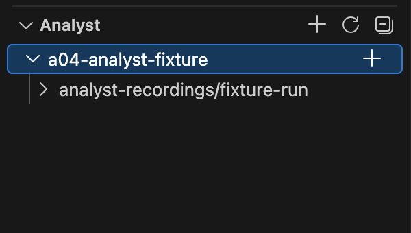
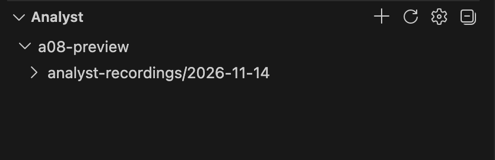

# The Analyst view

The **Analyst** view lists the recordings and the drafted journeys of each project. The [Analyst](../analyst/index.md) records a running application while a person uses it, then drafts the journeys that it saw, checks them and replays them. The view's **+** starts a recording. A click on a recording opens it as a page. The gear opens the passwords that the Analyst signs in with.

**In short**
- **+** (Record a journey) asks three questions, then starts `codelead analyst record` in a terminal. You drive the browser, and you mark where each journey starts and ends.
- A recording opens as a page: each step with what the person did, where it went, what the application answered and its screenshot.
- A right-click on a recording drafts its journeys, or states its rules and facts. A right-click on a draft checks, replays or confirms it.
- The gear opens **Analyst and Explorer** on the Settings page. A password shows only **set** or **not set**, never its value.



## Why it exists

An old application's behaviour is often known only by the people who use it. A recording keeps what a person does on the screens, and what the application answers. CodeLead turns it into journeys, which [the walk](../modernization/walk-and-parity.md) can replay on a new application. The view keeps this work beside the code, with no terminal to learn. See [Roles, journeys and steps](../analyst/concepts.md).

The view is in the pro plan. On the free plan, it shows one row with a lock: "Analyst is in CodeLead's Pro plan". Its buttons and menu items are hidden. See [Licence and plans](../concepts/licence-and-plans.md).

## What the view shows

Under each project, the view lists the folders that hold the Analyst's files, in `analyst-recordings/` and in `docs/codelead/journeys/`. A folder's label is its path, for example `analyst-recordings/2026-11-14`. A project with none says "No recordings or drafts yet".

Each file shows its kind as its description:

| File | Kind | A click opens |
|---|---|---|
| `recording.json`, `recording.md` | recording | The recording page. |
| `journeys.json`, `journeys.md` | draft | The file in the editor. |
| `journeys.confirmed.json` | confirmation | The file in the editor. |
| `rules.observed.md`, `facts.observed.md` | observation | The file in the editor. |

The file icon on any file row opens the file itself. See [Files the Analyst writes](../analyst/files.md).

## Record a journey

You need the application running, and its address. For the Basic Store sample, this is `http://localhost:5080/`. See [Start the old application for CodeLead](../modernization/source-run-profile.md).

1. Select **+** in the view's title bar, or the **+** on a project's row. With several folders, the title bar's **+** asks which project.
2. **Record (1 of 3)**: type the application's base address. The box keeps the last address that you gave.
3. **Record (2 of 3)**: type what you call the application, or leave it empty.
4. **Record (3 of 3)**: choose how the application's users sign in:
   - **New users**: the walk registers its own users through the screens.
   - **Given accounts**: the users exist already. Each sign-in name is kept as its account.
   - **Integrated**: Windows authentication. The browser signs in as one account by itself.
5. With **Integrated**, confirm the account, `DOMAIN\name`. The box holds this computer's account.

A terminal named **CodeLead Analyst: record** opens and runs the recorder. The line starts with the full path of the `codelead` command, for example:

```console
codelead analyst record --base http://localhost:5080/ --app 'Basic Store' --given-accounts
```

A message says what to do next:

```output
Drive the browser. Start and end each journey in the control window (or with Alt+Shift+S in the role's window); the recorder cuts the steps. Then run CodeLead: Draft from a recording.
```

On a Mac, the keys are Option+Shift+S. See [Record a journey](../analyst/record-a-journey.md).

> [!NOTE]
> **New to this?** A *journey* is one task that a person does in the application, such as "place an order". A *step* is one part of it, such as "open the catalog". You mark where each journey starts and ends. The recorder finds the steps.

### Windows sign-in

With **Integrated**, the browser signs in with this computer's own session. No password is needed. To sign in as another account, set the password `CODELEAD_WALK_PASSWORD_ALPHA` in the Analyst's settings. CodeLead never shows or prints it.

## The recording page

A click on a recording opens the tab `Recording · <time>`.


- **The header** gives the application's name and address, and how users sign in. It also gives the number of steps, the time span, the users with their roles, and the journeys. **JSON** and **Markdown** at the right open the source files.
- **Journey** and **Search** filter the steps across the whole recording.
- **The steps** come 100 to a page, with **Previous** and **Next**.

Each step is a card with its number, title, user, journey and duration, and these parts:

| Part | What it holds |
|---|---|
| **What the person did** | The actions in words: "Opened /catalog", "Clicked Browse", "Typed into Password (hidden)". |
| **Where it went** | The address before and after the step, and the page's title. |
| **What the application answered** | The requests, grouped, with their method, path and status. A failure is in red, with the application's message. |
| **What was seen** | The headings, the alerts and the dialogs on the page. |
| **Expected to see** | The expectations of the step, when there are any. |
| The screenshot | The page after the step. **Open screenshot full size** opens the image. |

The page never shows a typed value. A hidden field says "(hidden)".

## Draft, check, replay and confirm

Right-click a file in the view. The same commands are in the Command Palette, and in the right-click menu of the VS Code Explorer on `recording.json` and `journeys.json`.

| On | Command | What it does |
|---|---|---|
| A recording | **Draft from a recording** | Runs `codelead analyst draft <recording.json>`. Writes `journeys.json` and `journeys.md` beside it, shows the check's problems in the **Problems** panel, and opens the Confirm tab. See [From a recording to a specification](../analyst/from-recording-to-spec.md). |
| A recording | **Rules** | Runs `codelead analyst rules` on one or more recordings. Opens `rules.observed.md`. |
| A recording | **Facts** | Runs `codelead analyst facts` on one or more recordings. Opens `facts.observed.md`. |
| A draft | **Check journeys** | Runs `codelead analyst check <journeys.json>`. Problems go to the **Problems** panel, each at its place in the file. |
| A draft | **Replay** | Asks for the address, then runs `codelead analyst replay <journeys.json> --base <address>` in the terminal **CodeLead Analyst: replay**. |
| A draft or a confirmation | **Confirm** | Opens the Confirm tab, `Confirm · <folder>`. |

The Confirm tab lists the items of `journeys.md` by group, each with a box, a note and, for a step, **Open <step> in journeys.json**. Your choices go to `journeys.confirmed.json`. Each group's title counts the confirmed items, for example "Steps (3 of 5)".

A check with no problem says `<file> has no problems; CodeLead can walk it.` The output of every command goes to the output panel **CodeLead Analyst**.

## Settings and passwords

The gear in the view's title bar opens the Settings page at **Analyst and Explorer**.




- **Sign-in passwords**: one row for each role, with a password field, **Save** and **Remove**. The row says **set** or **not set**, never the value. **Save** writes `CODELEAD_WALK_PASSWORD_<ROLE>` to the project's `.env`. **Remove** deletes it.
- **Add a role** names a new role. The roles of the latest recording appear by themselves.
- **Credentials file**: the path of a credentials file, kept as `CODELEAD_WALK_CREDENTIALS` in `.env`. The page never reads the file.
- **App address** and **Analyst command**: the last address that you gave, and the command that runs the Analyst, each with **Change…**.

The page's help line says it:

```output
The Analyst signs in as the roles you name; each password is kept in this project's .env, never shown, never sent anywhere but the application being recorded.
```

See [Settings](settings.md#analyst-and-explorer) and [Passwords](../analyst/passwords.md).

> [!WARNING]
> `.env` holds the passwords in plain text. CodeLead's `init` keeps `.env` out of git. Do not commit it, and do not send it with a session export.

## Details

- **The Analyst command.** The setting `codelead.analystCommand` is empty by default. When it is empty, the extension runs `codelead analyst`, with the `codelead` command of `codelead.command`. Next it tries `analyst` on the PATH, then the build of an open Analyst workspace. A value that is not empty is run as you wrote it, `analyst` included. The **Analyst command** row on the Settings page shows the command that the extension resolves. See [Commands and settings of the extension](commands.md).
- **Trust.** Every Analyst command needs a trusted folder. Otherwise it says "CodeLead Analyst: trust this workspace before running an Analyst command."
- **The plan.** CodeLead's own commands check the plan, so a pro command refuses on the free plan even when you run it by hand. See [`codelead analyst`](../cli/codelead-analyst.md).
- **Refresh.** The view refreshes when files change under `analyst-recordings/` or `docs/codelead/journeys/`.

## Related content

- [The Analyst and the Explorer](../analyst/index.md)
- [Record a journey](../analyst/record-a-journey.md)
- [Passwords](../analyst/passwords.md)
- [`codelead analyst record`](../analyst/reference/analyst-record.md) and [`codelead analyst draft`](../analyst/reference/analyst-draft.md)
- [The Explorer view](explorer-view.md)
- [Tutorial: record journeys with the Analyst](../tutorials/record-journeys-with-the-analyst.md)
- [Journeys format](../reference/journeys-format.md)
