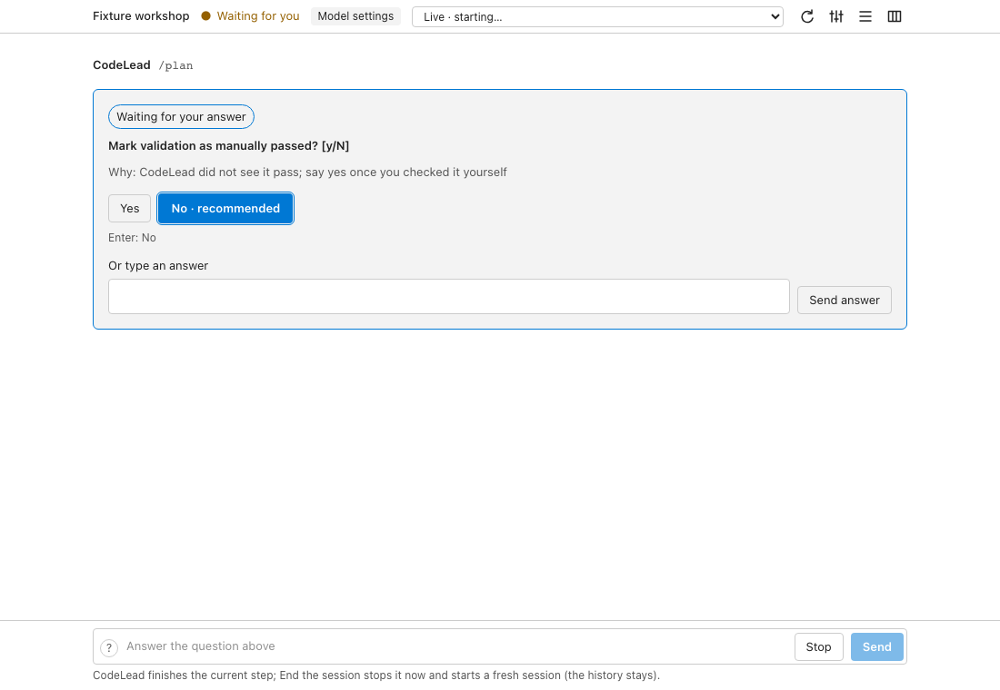
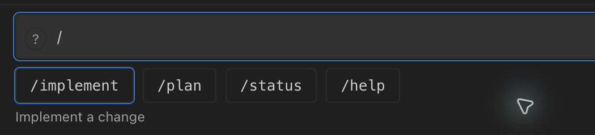
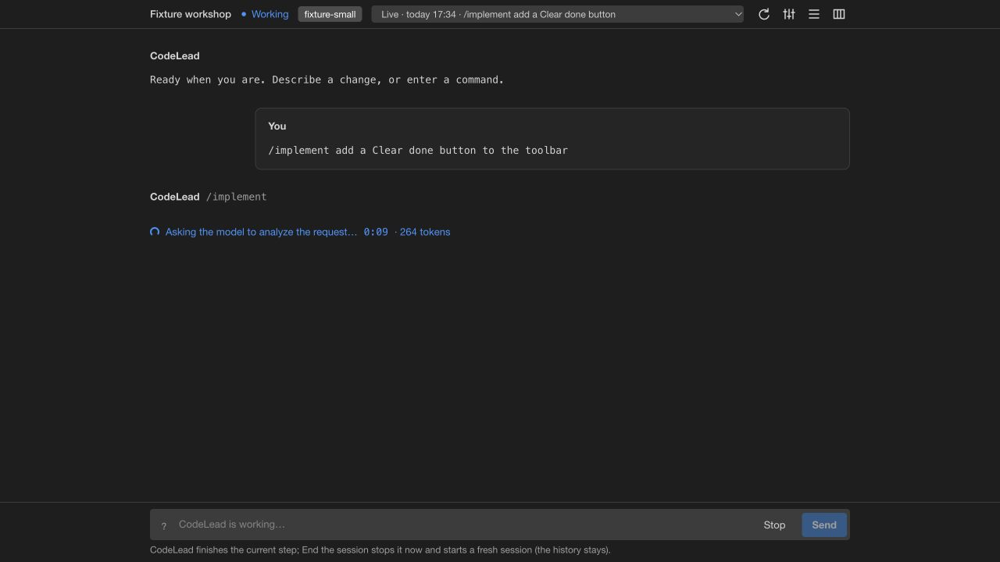
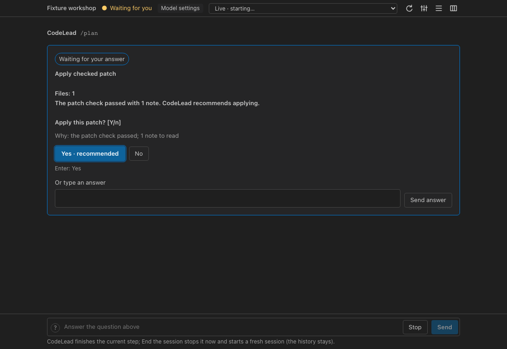
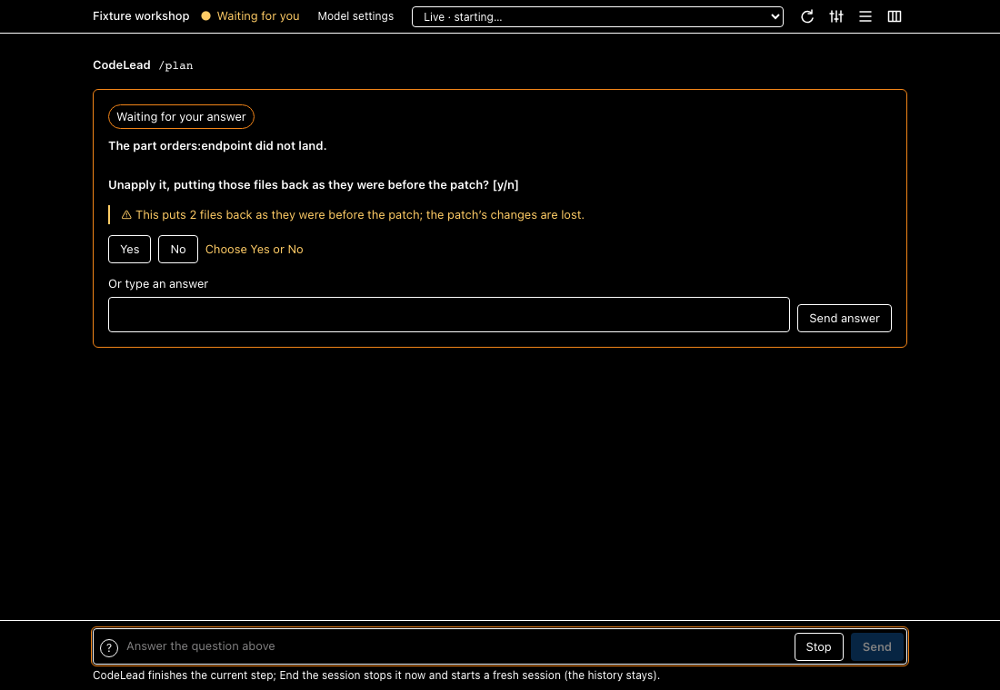
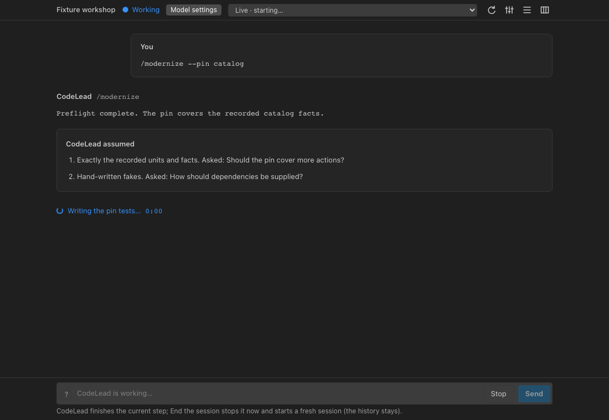
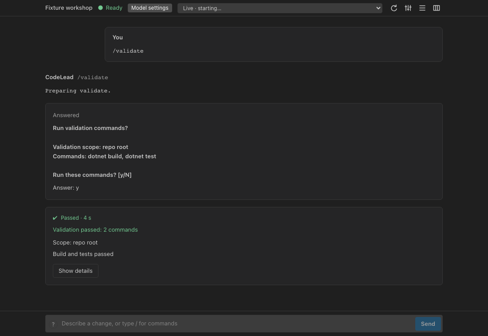
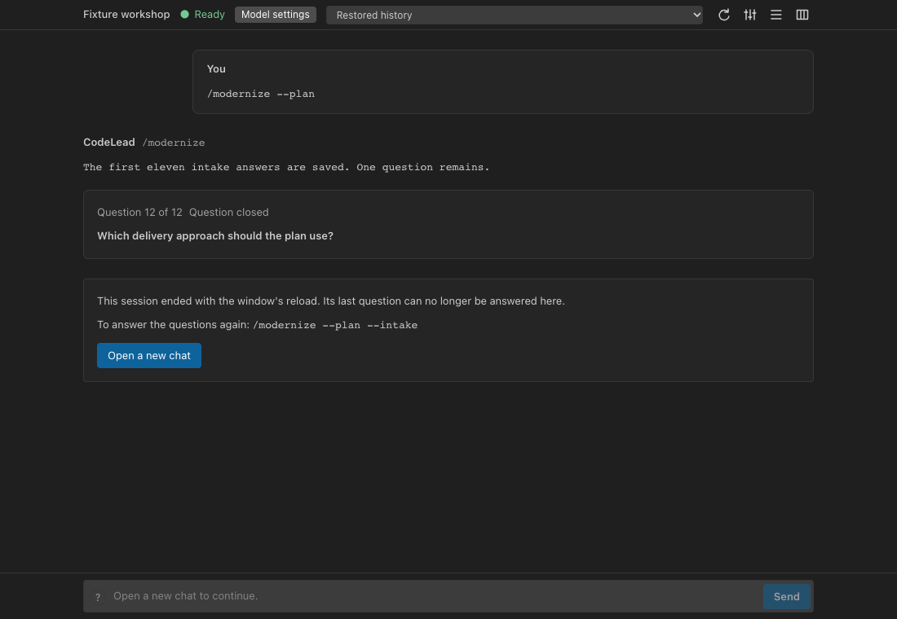

# The chat

The chat is a CodeLead session in an editor tab, one for each project. You type plain words or a [chat command](../chat-commands/index.md) such as [`/implement`](../chat-commands/implement.md). CodeLead's questions appear as cards with buttons, and every command ends with a result message that says what happened and what to do next.

**In short**
- Plain words go to CodeLead. A question gets an answer from your code. A request for a change gets the command to run, with **Yes** and **No**. A line that starts with `/` is a command.
- The header always says the state: **Working**, **Waiting for you** or **Ready**. A question that waits for you has a coloured border and a pill "Waiting for your answer".
- A failure is a red card with the reason, the ways out and **Retry**. A command with a verdict ends with a result message: **Passed**, **Failed**, **Stopped** or **Nothing to do**.
- **Stop** asks CodeLead to stop after the current step. Three seconds later, the button becomes **End the session**.



## Why it exists

A terminal session asks questions in text, and a person can miss one. The chat shows the same session with a clear state, buttons for each question, and a card for each failure. The engine is the same: the chat starts `codelead interactive --json-io` in the project folder, and each line that you send is what you would type in [`codelead interactive`](../cli/codelead-interactive.md). See [Sessions](../concepts/sessions.md).

## Open the chat

Use one of these ways:

- In the [Projects view](projects-view.md), select the project.
- Under the project, select **Start** > **Open the chat**.
- Select **Create an app** or **Implement a change**. The chat opens and runs the command.
- In the Command Palette, run **CodeLead: Open CodeLead chat**.

The tab is named `CodeLead · <project>`. It opens beside the file that you are editing, or in the first column. The chat shows the history of the project's last session first, then starts a fresh session. A folder without `.codelead/config.json` is offered **Initialize CodeLead** first.

## The header

The header is one row:

| Part | What it shows or does |
|---|---|
| The project's name | The project of this chat. |
| The state | A dot and a word: **Starting**, **Ready** (green), **Working** (blue), **Waiting for you** (amber), **Stopped** or **Error** (red). |
| The model badge | The model of the session. A click opens the Settings page. Before the session starts, it says **Model settings**. |
| **Session** | The list of the project's sessions: the live one first, then the older ones by date with their first words. See [Older sessions](#older-sessions). |
| Restart | Ends the session and starts a fresh one. The history stays. |
| Settings | Opens the [Settings page](settings.md). |
| Session log | Opens this session in the Session tab. See [The Sessions view](sessions-view.md). |
| Board | Opens the project's board. See [The Board view](board-view.md). |

Each icon button has a tooltip that says what it does in full words.

## Type a message

Type at the bottom, in the box "Describe a change, or type / for commands". Press Enter to send. Shift+Enter adds a new line. The box grows up to six lines. The small **?** at its left shows these rules.

### Plain words

Text that does not start with `/` goes to CodeLead's chat about the code. See [`/chat`](../chat-commands/chat.md).

- **A question** gets an answer from your code, with the files and lines that the answer rests on. For example, on the Basic Store sample: `how is the order total calculated?`
- **A request for a change** gets the command that CodeLead would run, for example `/implement add a due date to tasks`. Then CodeLead asks **Run it now?** with **Yes** and **No**. The command asks again before it changes a file.
- **In a folder with no source files**, a request gets `/create-app --auto <your words>` as its command. CodeLead then plans and builds a new app.

The chat never changes code by itself. Only a command changes code, and only after your answers.

> [!NOTE]
> **New to this?** You do not need to learn the commands first. Write what you want in plain words. The chat answers with the command, and you choose **Yes** or **No**.

> [!TIP]
> **For experienced users:** an older CodeLead does not route plain words. With it, the extension decides. In a folder with no source files, it sends `/create-app --auto <your words>`, with the note `This folder is empty, so CodeLead builds a new app: …`. Elsewhere it sends `/implement <your words>`.

### Commands

A line that starts with `/` goes to CodeLead as you typed it. For example:

```console
/validate
```

Every command of the [chat command reference](../chat-commands/index.md) works here. `/help` lists them.

### Completion

When the box starts with `/`, a row of choices appears under it, and follows what you type:

- After `/`, the commands that match, with what each one does.
- After a command and a space, its options, with the usage line as a hint. Where the command takes words, the row says "type your request".
- After `--card`, the board's cards, those tagged `for:codelead` first, with their column and tags. The hint says "`--card <id>`: a card from the board".
- After `--spec`, the spec files, with the number of journeys of each.

Use the up and down arrows to move, Tab or the right arrow to accept, and Esc to close the row. A click on a choice accepts it. Enter still sends a complete line.

The list comes from CodeLead's own table of commands, so it never differs from `/help`. With an older CodeLead, the row shows five fixed choices: `/implement`, `/create-app --auto`, `/plan`, `/status` and `/help`.

The row after `/`, in a sample where the list holds four commands:



## While CodeLead works

The header says **Working**. Under the last turn, a working line shows what runs, the time, and the tokens so far. For example: `Asking the model to analyze the request… 0:09 · 264 tokens`. CodeLead sends an update at least every 3 seconds during a model call. The box is disabled, with the words "CodeLead is working…".



### Stop and End the session

1. Select **Stop**. The button says **Stopping…**, and CodeLead is asked to stop after the current step. An open question gets no answer: a yes-or-no question is declined, and any other question takes its default.
2. When CodeLead is still busy 3 seconds later, the button becomes **End the session**. Select it to end the session now. A fresh session starts, and the history stays.

A command that cannot be cancelled goes on to its end. CodeLead says so in the turn: "Interrupt: the command in flight cannot be cancelled; it goes on to its end."

## The cards

A turn holds what CodeLead wrote, in the order it happened, and four kinds of cards.

### The question card

When CodeLead asks, the question appears as a card at the end of the turn. The chat scrolls to it and puts the focus on the recommended answer. The header says **Waiting for you**, and the box says "Answer the question above".

| Kind of question | What the card shows |
|---|---|
| Yes or no | **Yes** and **No**. The recommended answer is the one highlighted button, for example **Yes · recommended**. |
| A choice | One button for each option. The recommended option is highlighted in the same way. |
| A default value | A field with the value, a button such as **Use `<value>` · recommended**, and **Send answer**. |
| Free text | A field and **Send answer**. |

Under the question, the card says why CodeLead recommends its answer, for example "Why: the patch check passed". Under the buttons, a line says what Enter sends, for example "Enter: Yes".



A step that is hard to undo is different. The card shows what will be lost, no button is highlighted, and Enter sends nothing. You must choose. When you press Enter with no choice, the card says "Choose Yes or No".



> [!NOTE]
> The highlighted button and the "Enter:" line are in version 0.7.14 and later. See [Prompts and recommended answers](../concepts/prompts-and-recommended-answers.md) for the rule behind them.

Every card also has a field "Or type an answer". When CodeLead counts its clarifying questions, the card says "Question 2 of 9". An answered card goes quiet: it says **Answered** and shows the answer.

For what each question means and what CodeLead recommends, see [Prompts and recommended answers](../concepts/prompts-and-recommended-answers.md).

### The information card

Some commands answer their clarifying questions by themselves and tell you once. The card is neutral, with a title such as **CodeLead assumed** and a numbered list. It has no **Retry**, and the command goes on: it is not a failure.



### The problem card

When a command stops short of its goal, the turn shows a card with a red border:

- The title, for example **Implementation stopped** or **The model call failed**.
- The reason, in CodeLead's words.
- The ways out, as a list.
- **Retry**, which sends the command again.
- **Open Settings**, when the reason names a model, a provider or a key.
- **Session log**, which opens the Session tab.

The turn's footer then says how long it ran, for example "Failed after 2 min 38 s". See [Results and stops](../concepts/results-and-stops.md#problem-cards).


### The result message

A command with a verdict ends with one result message:

- A mark and a word: **Passed** (✔), **Failed** (✖), **Stopped** (■), **Nothing to do** (○) or **Done** (✔), with the time it took.
- The headline, one sentence.
- The facts, as short lines.
- The next steps. A step that starts with `/` is a button that sends that command.
- **Show details**, which opens the full output of the step, such as the validation's output. **Open file** opens a file that the result names.


The same command when it passes:



A command without a verdict, such as `/help` or `/status`, shows its answer and a footer such as "Done in 3 s". An older CodeLead sends no result. Its turns end with the footer only.

## Older sessions

1. Open the **Session** list in the header.
2. Choose an older session. The chat shows it, and says "You are reading an older session."
3. Select **Back to the live session** to return.

While you read an older session, you cannot send anything. The live session keeps running, and its lines wait for you.

## A restored chat

When VS Code reloads the window, the chat tab comes back with its history. Its session belonged to the window that is gone, so the chat cannot go on with it. At the end of the history, a notice says so:

- "This session ended with the window's reload. Its last question was declined; nothing was applied." when the log shows that a yes-or-no question got no answer.
- "This session ended with the window's reload. Its last question was answered with the default." when the log shows that the last question took its default.
- "This session ended with the window's reload. Its last question can no longer be answered here." in other cases.
- After `/modernize --plan`, it adds "To answer the questions again: `/modernize --plan --intake`".

Select **Open a new chat** to start a fresh session in the same tab. The header says **Ready**, never **Waiting for you**, for a restored chat. Its old questions show as history, without buttons.



## When the session stops

When the session ends or fails, a bar above the box shows CodeLead's words and **Restart**. Examples:

```output
CodeLead could not start: the command was not found: install CodeLead or set codelead.command
The session ended.
```

A remote model that the privacy settings block also stops the session before it starts. Turn on **Allow remote models** on the Settings page when the code's owner agrees. See [Troubleshoot the extension](troubleshooting.md).

## What it is not

- **Not a separate assistant.** The chat is a CodeLead session. It has the same commands, questions and rules as the terminal.
- **Not a place where code changes without you.** A change goes through a command, [the patch check](../concepts/the-patch-check.md) and your answers.
- **Not stored in the extension.** The history is the session log in `.codeleadsessions/`. See [Sessions](../concepts/sessions.md).

## Details

- **The process.** The extension starts the `codelead` command of the setting `codelead.command` with `interactive --json-io`, in the project folder, with `FORCE_COLOR=0` and `NO_COLOR=1`. Each message is one JSON line, protocol `codelead.session-io/1`. See [Session protocol](../reference/session-io-protocol.md).
- **A supervisor.** A small process holds the session's input open. When the extension stops unexpectedly, the session is ended, and no open question is answered by default.
- **Closing the tab.** Closing the tab ends its session. The extension sends `exit` and closes the input. It waits up to 5 seconds before it stops the process.
- **One chat for each project.** Opening the chat of a project that has one shows the existing tab. An action into a chat whose session ended starts a new session.
- **The plan.** A newer CodeLead names the folder's plan on the session's first line, and the extension uses it. See [Licence and plans](../concepts/licence-and-plans.md).
- **The log.** The extension writes its own lines and CodeLead's error output to the output panel **CodeLead**.

## Related content

- [Chat command reference](../chat-commands/index.md)
- [`/chat`](../chat-commands/chat.md), [`/implement`](../chat-commands/implement.md), [`/validate`](../chat-commands/validate.md) and [`/create-app`](../chat-commands/create-app.md)
- [Prompts and recommended answers](../concepts/prompts-and-recommended-answers.md)
- [Results and stops](../concepts/results-and-stops.md)
- [Sessions](../concepts/sessions.md)
- [The Sessions view](sessions-view.md)
- [Quickstart: CodeLead in VS Code](../get-started/quickstart-vscode.md)
- [Troubleshoot the extension](troubleshooting.md)
