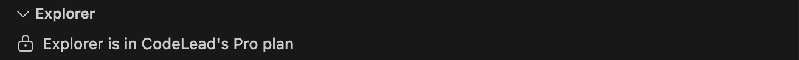

# The Explorer view

The **Explorer** view lists the explorations of each project. The Explorer visits a running application by itself, as each role that you name, and maps its screens, its forms and its workflows. It needs no source code. The view's **+**, **Explore an application**, asks four questions and starts the exploration, and the view then lists what the Explorer wrote.

**In short**
- **+** asks for the address, how users sign in, the safety layer and the number of screens, then runs `codelead analyst explore`.
- **Observe only**, the default, follows links, menus and buttons, and sends no form. **Try forms** sends each form with made-up values, and never a password.
- Each exploration lists its **Site map**, **Forms** and **Stories**, then the rules, the facts, the drafts and the recordings of each role.
- The view is in the pro plan.


## Why it exists

A team that must modernize or document an application often lacks its source, or its users' time. The Explorer gives a first map of the application in minutes: which screens exist, which forms they hold, and which workflows connect them. The [modernization program](../modernization/the-program.md) uses it in its Read stage. See [Explore an application](../analyst/explore-an-application.md).

On the free plan, the view shows one row with a lock, and its buttons are hidden:



## Explore an application

You need the application running, and its address. For the Basic Store sample, this is `http://localhost:5080/`.

1. Select **+** in the view's title bar, or the **+** on a project's row.
2. **Explore (1 of 4)**: type the application's base address. The box keeps the last address that you gave.
3. **Explore (2 of 4)**: choose how the users sign in:
   - **New users**: explore as a visitor without existing accounts.
   - **Given accounts**: type role and account pairs, separated by commas, for example `clerk=store.clerk, admin=store.admin`. The passwords come from `CODELEAD_WALK_PASSWORD_<ROLE>` in the project's environment, else from the **Credentials file** of the Settings page.
   - **Integrated**: Windows authentication. Confirm the account, `DOMAIN\name`. This computer's account needs no password.
4. **Explore (3 of 4)**: choose the safety layer:
   - **Observe only (default): follows links, menus and buttons, sends no form**, with the detail "A button can still change data: explore a test copy."
   - **Try forms: sends each form with made-up values, never a password**

   A button can change data even when no form is sent, so explore a test copy of the application.
5. **Explore (4 of 4)**: type the maximum number of screens for each role. The default is 200.

The extension runs the Explorer, for example:

```console
codelead analyst explore --base http://localhost:5080/ --given-accounts --as clerk=store.clerk --max-screens 200 --out analyst-recordings/2026-11-20T06-30-00-000Z
```

A notification, **CodeLead Analyst: Exploring**, shows each line as it comes, and has **Cancel**. The full output goes to the output panel **CodeLead Analyst**. When the exploration ends, the view refreshes and the new **Site map** opens.

> [!IMPORTANT]
> Choose **Try forms** only on a copy of the application that can receive test data. It sends each form twice, empty and then with made-up values, and the forms write what they write. It never sends a form with a password field, or a button that deletes, removes or signs out. **Observe only** sends no form.

> [!NOTE]
> **New to this?** A *role* is a kind of user, such as a clerk or an administrator. The Explorer explores once for each role, because each role sees different screens.

Set the passwords before you explore with given accounts: the gear in the view's title bar opens **Analyst and Explorer** on the Settings page. See [Settings](settings.md#analyst-and-explorer) and [Passwords](../analyst/passwords.md).

## What the view shows

Under each project, the explorations are listed newest first. An exploration is a folder `analyst-recordings/<time>/` that holds `sitemap.json`. A folder with recordings only is not an exploration: it is in the [Analyst view](analyst-view.md).

Each exploration's label is its time and the roles that it explored, for example `2026-11-13T02-00-00-000Z · clerk, visitor`. Its description counts the screens and the forms: `2 screens · 1 form`.

Under it, the files that exist:

| Row | File | What it holds |
|---|---|---|
| **Site map** | `sitemap.md` | The screens, and the links and menus between them. |
| **Forms** | `forms.md` | The forms on the screens, with their fields. |
| **Stories** | `stories.md` | The workflows, as user stories. |
| **Rules** | `rules.observed.md` | The rules that the screens show. |
| **Facts** | `facts.observed.md` | The facts that the screens show. |
| **Draft** | `journeys.md` | The drafted journeys of the exploration. |
| **Recording · <role>** | `explore-<role>/recording.json` | The role's visit, step by step. It opens as the recording page. |
| **Recording · <role> (Markdown)** | `explore-<role>/recording.md` | The same visit in Markdown. |
| **Draft · <role>** | `explore-<role>/journeys.md` | The drafted journeys of the role. |

A click opens the file, or the recording page for a recording. See [The Analyst view](analyst-view.md#the-recording-page) and [Files the Analyst writes](../analyst/files.md).

A project with no exploration says "No exploration yet; press + to explore an application."

## When the exploration stops

- **A failure.** The message says "CodeLead Analyst: exploration stopped. See the CodeLead Analyst output for the reason." The output panel **CodeLead Analyst** has the Explorer's own words.
- **Cancel.** The extension stops the Explorer, and writes "Exploration cancelled." in the output panel. What the Explorer wrote before stays in its folder.
- **An untrusted folder.** The **+** and **Explore an application** in the Command Palette are hidden. When you run the command another way, such as from a keyboard shortcut, it says "CodeLead Analyst: trust this workspace before running an Analyst command."
- **Windows.** The command can refuse an answer with quotes, `%`, `!` or a new line, because the Windows `.cmd` file cannot pass them safely. Set `codelead.analystCommand` to a direct program to pass such values.

## Details

- **The folder.** The extension names the output folder from the time of the start, in UTC.
- **The limit.** **Maximum screens per role** is `--max-screens`. It takes a whole number from 1.
- **Cancel.** Cancel sends a stop signal to the Explorer, and forces it to stop 3 seconds later.
- **The plan.** CodeLead's Explorer checks the plan itself. See [Licence and plans](../concepts/licence-and-plans.md).

## Related content

- [Explore an application](../analyst/explore-an-application.md)
- [`codelead analyst explore`](../analyst/reference/analyst-explore.md)
- [The Analyst view](analyst-view.md)
- [Limits](../analyst/limits.md)
- [The eight stages](../modernization/the-eight-stages.md)
- [Settings](settings.md)
