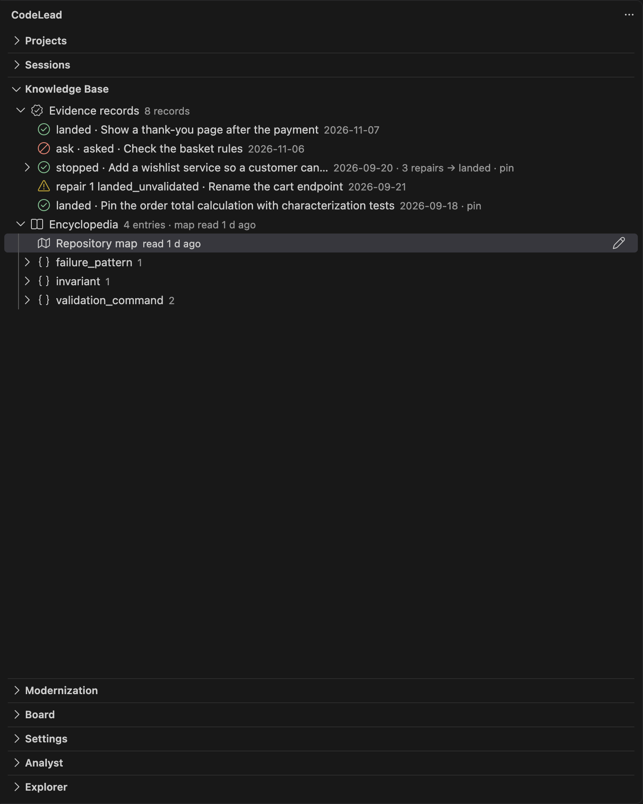

# CodeLead for VS Code

CodeLead for VS Code puts CodeLead inside the editor. It adds a CodeLead icon to the activity bar, eight views and a chat in an editor tab. It also adds pages for the settings, the sessions, the board and the modernization program. The extension runs the same `codelead` command that you run in a terminal, so the chat and the terminal give the same results.

**In short**
- The extension is a window on CodeLead. It reads the files that CodeLead writes, and it runs the `codelead` command for you.
- Nothing changes in a folder until you select **Initialize CodeLead in this folder**.
- The chat is a CodeLead session: questions become buttons, and every command ends with a result message.
- The free plan shows five views in full. The Analyst, Explorer and Modernization views need the pro plan.

## Where to start

- **I am new to CodeLead**: follow [Quickstart: CodeLead in VS Code](../get-started/quickstart-vscode.md). It takes about ten minutes. Then read [A tour of the extension](tour.md).
- **I already use coding agents**: read [The chat](chat.md). It explains the cards, the result message and how a question waits for you. Then read [How CodeLead works](../concepts/how-codelead-works.md).
- **I lead a team**: read [The Knowledge base view](knowledge-base-view.md) and [The Board view](board-view.md). Every change leaves an [evidence record](../concepts/evidence-records.md), and the board holds the work that waits on people.

## What the extension is

- **A client of CodeLead.** The extension contains no model. Its chat starts `codelead interactive --json-io` in the project folder, and its buttons run other `codelead` commands. See [Install the extension](install.md).
- **A reader of CodeLead's files.** The views show the session logs, the evidence records and the knowledge base. They also show the run journal, the modernization documents and the board. They refresh when CodeLead writes.
- **Local.** The extension sends nothing anywhere. A model call goes from CodeLead to the provider that you configured. See [Privacy and remote models](../concepts/privacy-and-remote-models.md).

> [!NOTE]
> **New to this?** The *activity bar* is the column of icons on the far left of VS Code. A *view* is one section of the side bar, such as **Projects** or **Board**. A *tab* is a page in the editor area.

## The views and the plans

A CodeLead licence names a plan, **free** or **pro**. See [Licence and plans](../concepts/licence-and-plans.md). The extension reads the plan with `codelead licence --json`, and shows the views by it.

| View | Plan | What it shows |
|---|---|---|
| [Projects](projects-view.md) | Free | Each CodeLead project, how to start a session, and the run journal. |
| [Sessions](sessions-view.md) | Free | The project's session logs. A click opens the Session tab. |
| [Knowledge base](knowledge-base-view.md) | Free | The evidence records and the encyclopedia, with the repository map. |
| [Modernization](modernization-view.md) | Pro, except the specs | The dossier, the rebuild plan, the audit pack, and the [Modernize wizard](modernize-wizard.md). |
| [Board](board-view.md) | Free | The project's board, by column. A click opens the board page. |
| [Settings](settings.md) | Free | The project's settings, and the Settings page. |
| [Analyst](analyst-view.md) | Pro | The recordings and the drafted journeys. |
| [Explorer](explorer-view.md) | Pro | The explorations of a running application. |

On the free plan, all eight views stay in the side bar. A pro view shows one row with a lock, such as "Explorer is in CodeLead's Pro plan", and its buttons are hidden. The Modernization view still lists the specs, because the spec walk is free.

## Get started

- [Quickstart: CodeLead in VS Code](../get-started/quickstart-vscode.md)
- [Install the extension](install.md)
- [A tour of the extension](tour.md)

## Tutorials

- [Build a new app, step by step](../tutorials/build-a-new-app.md)
- [Change existing code with evidence](../tutorials/change-existing-code.md)
- [Modernize a .NET Framework application](../tutorials/modernize-a-dotnet-framework-app.md)
- [Record journeys with the Analyst](../tutorials/record-journeys-with-the-analyst.md)

## The views and pages

- [The Projects view](projects-view.md)
- [The chat](chat.md)
- [The Sessions view](sessions-view.md)
- [The Knowledge base view](knowledge-base-view.md)
- [The Modernization view](modernization-view.md)
- [The Modernize wizard](modernize-wizard.md)
- [The Board view](board-view.md)
- [The Analyst view](analyst-view.md)
- [The Explorer view](explorer-view.md)

## Concepts

- [How CodeLead works](../concepts/how-codelead-works.md)
- [New apps: steps, increments and the run report](../concepts/new-apps.md)
- [Results and stops](../concepts/results-and-stops.md)
- [Prompts and recommended answers](../concepts/prompts-and-recommended-answers.md)
- [Licence and plans](../concepts/licence-and-plans.md)

## Reference

- [Settings](settings.md)
- [Commands and settings of the extension](commands.md)
- [Troubleshoot the extension](troubleshooting.md)
- [Chat command reference](../chat-commands/index.md)
