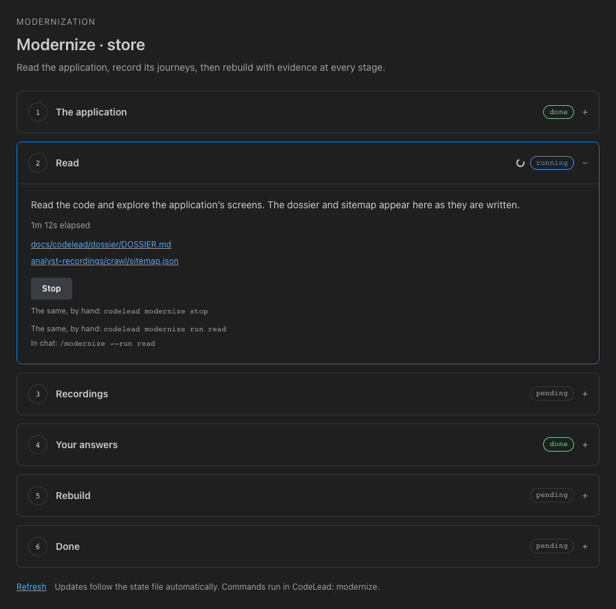
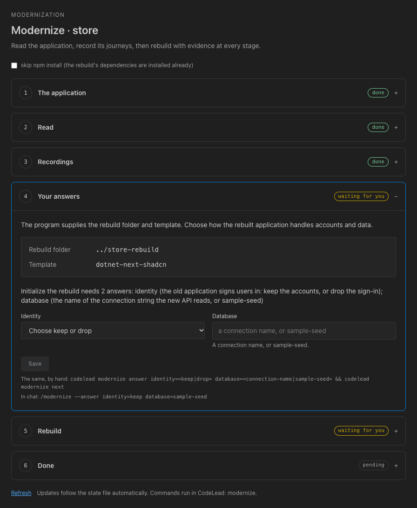

# The Modernize wizard

The Modernize wizard is a page in VS Code that drives the [modernization program](../modernization/the-program.md). It shows the eight stages of a modernization as six steps, with the status of each, and one button for each thing that you do. Every button runs a `codelead modernize` command in a terminal that you can read, and the page shows that command under the button.

**In short**
- Open the wizard with the rocket, **Modernize this application**, in the [Modernization view](modernization-view.md). It needs the pro plan.
- You select **Start**, record the journeys, select **Continue**, give two answers, and select **Save**. CodeLead runs the other stages by itself.
- A stage that fails shows a card with the reason, how to continue, **Retry**, **Stop** and **Skip this stage…**.
- The page reads `.codelead/modernization.json` and follows it. It never calls a model.



## Why it exists

A modernization has eight stages and many commands. A person can forget a command, or run one too early. The wizard shows where the program stands, and offers only the buttons that make sense now. Nothing is hidden: each button shows the exact command, so you can run it by hand in a terminal or type it in the chat. This page describes the wizard. For the stages themselves, read [The eight stages](../modernization/the-eight-stages.md). For a full run on the Basic Store sample, follow the [tutorial](../tutorials/modernize-a-dotnet-framework-app.md).

## Open the wizard

1. Open the old application's folder in VS Code. It must hold `.codelead/config.json`. See [Install the extension](install.md#initialize-a-folder).
2. In the **Modernization** view, select the rocket, **Modernize this application**. You can also run **CodeLead: Modernize this application** in the Command Palette.
3. When the window has several projects, choose one in the list **Modernize which project?**.

The tab `Modernize · <project>` opens. On the free plan, the rocket is hidden, and the command says "CodeLead: modernization requires Pro." See [Licence and plans](../concepts/licence-and-plans.md).

## The page

The top of the page says `Read the application, record its journeys, then rebuild with evidence at every stage.` Under it is a checkbox: **skip npm install (the rebuild's dependencies are installed already)**. It adds `--no-install` to the commands `next`, `continue` and `run`. It is off by default.

The six steps follow, each with its status: **pending**, **running** (with a spinner), **waiting for you**, **done**, **failed** or **skipped**. The current step is open. Select a step's title to open or close it.

| Step | The stages of the program | What you do |
|---|---|---|
| 1. The application | None: the start | Type the address, choose the mode, select **Start**. |
| 2. Read | `read` | Wait. Select **Stop** to stop it. |
| 3. Recordings | `recordings` | Record the journeys with the Analyst, then select **Continue**. |
| 4. Your answers | `rebuild-init`, its answers | Choose **Identity**, type **Database**, select **Save**. |
| 5. Rebuild | `pins`, `in-place`, `model`, `rebuild-init`, `rebuild` | Answer in the terminal when the mode asks you. Use **Retry** on a problem. |
| 6. Done | `audit` | Bring back the cards, the evidence records and the audit pack. |

Under every button, small type gives the same command, by hand and in the chat. For example:

```output
The same, by hand: codelead modernize start --base http://localhost:5080/
In chat: /modernize --run read
```

### 1. The application

The step shows the **Folder**, the **Web project** and the **Kind**. Before Read runs, the last two say "Identified when Read runs".

- **Application address**: the address of the running old application, for example `http://localhost:5080/`. It is optional. With it, the Read stage also explores the screens. You can change it until the program starts.
- **Mode**: **Approve each landing** (the default), or **Run unattended**. See [Approve mode and unattended mode](../modernization/the-program.md#approve-mode-and-unattended-mode).
- **Start** runs `codelead modernize start`, with `--base <address>` and `--unattended` when you chose them.

When the folder holds several web projects, the program refuses to start and names them. The page then shows the list **Choose web project**. Choose one and select **Start** again: the command gets `--project <name>`.

### 2. Read

The step says `Read the code and explore the application's screens. The dossier and sitemap appear here as they are written.` It shows the time so far, and a link to each output, such as `docs/codelead/dossier/DOSSIER.md`. A dossier page opens as a page of the Modernization view. While the stage runs, **Stop** runs `codelead modernize stop`. See [The dossier](../modernization/dossier.md).

### 3. Recordings

The program waits for you here. The step shows the program's own instructions, for example the title "Record the journeys" with what to record and how.

1. In the [Analyst view](analyst-view.md), select **+**, **Record a journey**, and walk through the application.
2. The recordings appear in the step's list as you make them. A click opens the recording page.
3. When the journeys that you need are recorded, select **Continue**. It runs `codelead modernize continue`.

See [Record a journey](../analyst/record-a-journey.md).

### 4. Your answers



"The program supplies the rebuild folder and template. Choose how the rebuilt application handles accounts and data."

- **Rebuild folder** and **Template** are read only. The program fills them: `../<folder>-rebuild` and `dotnet-next-shadcn` by default.
- **Identity**: **Keep** keeps the old application's accounts. **Drop** drops the sign-in. With **Keep**, no part of the rebuild's plan builds the directory that checks a password outside Development and the tests. The plan says so in a note, and a person adds it. See [The rebuild](../modernization/rebuild.md#the-manifest).
- **Database**: the name of the connection string that the new API reads, or `sample-seed`.
- **Save** runs `codelead modernize answer identity=<keep|drop> database=<name>`, then `codelead modernize next`.

The step stays **pending** until the program asks for the answers, then says **waiting for you**, and **done** once they are recorded. See [The answers](../modernization/the-program.md#the-answers).

### 5. Rebuild

The step says `The program runs the remaining stages in order and stops when it needs your answer.` It tells you to follow the output in **CodeLead: modernize**. It lists the stages, each with its status, its time, its outputs, its evidence records and its command:

- **Pin the contracts** (`pins`). See [Pins](../modernization/pins.md).
- **Transform in place** (`in-place`). See [Transforms](../modernization/transforms.md).
- **Extract the model** (`model`). See [The System Model](../modernization/system-model.md).
- **Initialize the rebuild** (`rebuild-init`).
- **Build and verify** (`rebuild`). See [The rebuild](../modernization/rebuild.md).

A click on an evidence id opens the record's page. When `.codelead/rebuild-report.html` exists in the project's folder, the step shows the rebuild report under the list.

Under **Pin the contracts**, a muted line says: "When the project has no narration, the stage asks in its terminal whether to write one first. Yes is recommended."

Under **Transform in place**, a muted line counts the security findings that another transform or the rebuild closes, with their classes. For example: "1 finding is closed by another transform or the rebuild: end-of-life-runtime". You decide nothing for them.

In approve mode, the commands ask before each landing. Answer in the terminal **CodeLead: modernize**: type `y` or `n` and press Enter.

### 6. Done

The step shows the audit stage's outputs, such as the audit pack's page. A short list says what to bring back: the cards parked on the board, the evidence records for the landings, and the audit pack. See [The audit pack](../modernization/audit-pack.md).

## When a stage fails or waits

A stage that failed, or that waits for you, shows a card with a yellow border:

- The title and the reason, in the program's words.
- **How to continue**: the fix, in full.
- **Retry**: runs the stage again with the line that the program gave, for example `codelead modernize run rebuild`.
- **Stop**: runs `codelead modernize stop`.
- **Skip this stage…**: goes past the stage, with your reason. See [Skip a stage](#skip-a-stage).


**Retry** runs only a `codelead modernize run <stage>`, `next` or `continue` line. Any other line is refused with "This retry line is not a supported modernization command. Run the displayed line by hand after checking it."

### Skip a stage

A stage that failed or waits for you can be skipped, except the recordings. Skip it when the cause cannot be fixed now, and the program must go on without it.

1. Select **Skip this stage…**. A field opens: **Reason for skipping <stage>**.
2. Type why. The reason is required. Without it, the page says "Say why this stage is skipped: the audit pack keeps the reason".
3. Select **Skip stage**. It runs `codelead modernize skip <stage> --reason '<your reason>'`. The line under the button shows it, quoted for your shell.


The skipped stage then shows a muted line: "Skipped by you on <date>: <reason>". The skip does not run the next stage. When a stage is skipped, stages are pending, and no stage failed or waits, a separate **Continue** button appears under the steps. It runs `codelead modernize next`. See [`codelead modernize skip`](../cli/codelead-modernize-skip.md).

### Security decisions

The Upgrade in place stage can wait on security findings whose fix changes who may do what. The card then keeps the program's full explanation, and lists each finding with two lines for the chat:

- `/modernize --waive <finding> --reason <why>`: waive it, with your reason.
- `/modernize --transform S --security <finding>`: fix it on purpose.

Each line has two buttons. **Copy** copies the line. **Open the chat** puts the line in the chat's message box, and does not send it: you complete the reason, then send it yourself.

Three plain answers follow, each with its command by hand:

| Button | What the stage does then | The command |
|---|---|---|
| **I decided each one** | It leaves each finding as you decided: waived with its reason, or fixed on purpose. | `codelead modernize answer security=decided` |
| **Fix them all** | It fixes every open decision finding on purpose, never a waived one. | `codelead modernize answer security=fix-all` |
| **Leave them open** | It leaves them open. Waive each with its reason, so that the audit pack says why. | `codelead modernize answer security=fix-none` |

The card has no **Retry** while the findings wait. Once one of the three answers is recorded, **Run the stage again** appears. See [Waive a security finding](../how-to/waive-a-security-finding.md).


> [!TIP]
> **For experienced users:** the waiting card of the Pin stage can say that facts still wait at a lower level. **Retry** runs the stage again. To accept the coverage, run `codelead modernize answer pins=enough` in the terminal. See [Pins](../modernization/pins.md). The Build and verify stage can wait too, with the parts of the rebuild that wait for you. To go on with what is built, run `codelead modernize answer rebuild=enough` in the terminal. See [The eight stages](../modernization/the-eight-stages.md#7-rebuild).

## When a command is refused

The program refuses a command with exit code 2. A refusal is not a failed stage. The page shows a card **Refused** with the last lines of the terminal, and no **Retry**. It adds: "After resolving this, refresh to return to the program's current stage". A skip or a security answer that ends with exit code 1 shows its own output in the same card, not a general failure. Typical refusals:

- A program that runs in another process. The program holds one run at a time, with the folder's run lock. See [One program at a time](../modernization/the-program.md#one-program-at-a-time).
- `start` in a folder with several web projects, without `--project`.
- A state file that cannot be read.

The page also refuses its own buttons while a command runs: "A modernization command is running. Use its terminal or Stop."

## What the page shows when it cannot work

| Message | What it means | What to do |
|---|---|---|
| "This CodeLead has no `modernize` command yet. Update CodeLead, or run the steps by hand:" | The installed CodeLead is older than the program. The page lists the manual commands in order. | [Update CodeLead](../how-to/update-codelead.md), or run the listed commands. |
| "CodeLead could not answer. Check codelead.command and the installation, then refresh this page." | `codelead modernize status --json` did not answer within 10 seconds. | Check the setting `codelead.command`, and run `codelead --version` in a terminal. |
| "Trust this workspace to run modernization." | The folder is not trusted. | Trust the folder in VS Code. |
| "The modernization state could not be read. Check .codelead/modernization.json, then refresh this page." | The state file is not valid. | Fix or restore the file, then select **Refresh**. See [Modernization state file](../reference/modernization-state-file.md). |

## How the page works

- **One terminal.** Every command runs in the terminal **CodeLead: modernize** of the project. The page reuses it. When the terminal closes, a running command stops.
- **The state file.** The page reads `.codelead/modernization.json`. It refreshes when that file, the rebuild report or `analyst-recordings/` changes. **Refresh** at the bottom reads everything again.
- **Stage names.** Each stage shows its title from the state file. When the file has no title for a stage, for example before the program starts, the page uses the stage's short name. The eight short names are Read, Observe, Pin, Upgrade in place, Model, Set up the rebuild, Rebuild and Hand over.
- **Two commands for Save.** The answers run first. `next` runs only when they succeed.
- **Safe values.** The page sends fixed verbs and separate words. On Windows, it refuses a value with `%`, `!`, `^` or quotes: "This Windows command contains a cmd expansion character. Use a plain path or connection name."
- **No model, no secrets.** The page never calls a model and never reads `.env`. Its links open only files inside the project, never `.env` files or session logs.

> [!NOTE]
> **For team leads:** the wizard, the terminal commands and the chat's `/modernize --run` drive the same program and the same state file. A person can start in the wizard and continue in a terminal. Every landing writes an [evidence record](../concepts/evidence-records.md).

## What it is not

- **Not a second program.** The wizard runs the `codelead modernize` commands. It adds no stage and no rule.
- **Not the only status view.** [`codelead modernize status`](../cli/codelead-modernize-status.md) prints the same state.
- **Not for Web Forms pages.** The program reads ASP.NET MVC in full. See [What works today, and what does not](../modernization/index.md#what-works-today-and-what-does-not).

## Related content

- [The modernization program](../modernization/the-program.md)
- [The eight stages](../modernization/the-eight-stages.md)
- [Tutorial: modernize a .NET Framework application](../tutorials/modernize-a-dotnet-framework-app.md)
- [`codelead modernize`](../cli/codelead-modernize.md), [`codelead modernize start`](../cli/codelead-modernize-start.md) and [`codelead modernize answer`](../cli/codelead-modernize-answer.md)
- [`/modernize`](../chat-commands/modernize.md)
- [The Modernization view](modernization-view.md) and [The Analyst view](analyst-view.md)
- [Modernization state file](../reference/modernization-state-file.md)
