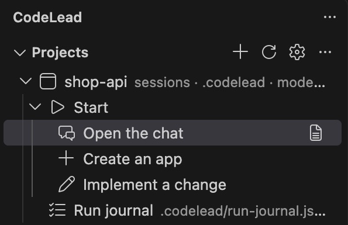

# The Projects view

The **Projects** view is the first view of the CodeLead side bar. It lists each folder of the window that holds CodeLead files. It is where you start work: the chat, a new app, or a change. In a folder with no CodeLead files, it shows the welcome with the button **Initialize CodeLead in this folder**.

**In short**
- A click on a project opens its chat. Under each project, the **Start** row has three ways in: **Open the chat**, **Create an app** and **Implement a change**.
- **Run journal** appears under a project after a build in increments. It opens the build's journal page.
- The title bar has **+** (Create an app), refresh, the gear for the model settings, and a **…** menu with five more actions.



## Why it exists

A person who opens CodeLead for the first time needs one place that says how to begin. The Projects view is that place. Each way in sends a CodeLead command to the project's [chat](chat.md), so you see every question and every result there.

## What the view shows

### The welcome

When no folder of the window holds CodeLead files, the view shows this text and one button:

```output
This folder has no CodeLead files yet. Initialize CodeLead to start: it writes `.codelead/config.json`, sets up the board in `docs/codelead/board`, and keeps your `.env` out of git. Nothing happens without this click.
[Initialize CodeLead in this folder]
Already have the files? Open the folder that holds them.
```

The button runs `codelead init`, then `codelead board init`. See [Install the extension](install.md#initialize-a-folder).

### The projects

A folder is a project when it holds `.codelead/`, `.codeleadsessions/` or `docs/codelead/`. The extension also finds projects up to two folders deep, for example a new app built inside a repository. Such a project must hold its own `.codelead/` or `.codeleadsessions/`. It does not look inside `node_modules`, `bin`, `obj`, `dist`, `out`, `build`, `packages` or `docs`.

Each project row shows its name. Its description lists what the folder holds: `sessions`, `.codelead`, `modernization` and `board`. The tooltip shows the folder's path.

- **A click on a project** opens its chat, a tab named `CodeLead · <project>`.
- **A right-click on a project** offers **Open CodeLead chat**.

### The Start row

Under each project, **Start** is open by default. It has three rows:

| Row | What it does |
|---|---|
| **Open the chat** | Opens the project's chat, with the history of the last session. See [The chat](chat.md). |
| **Create an app** | Asks "What should the app do?", then sends `/create-app --auto <your words>` to the chat. See [`/create-app`](../chat-commands/create-app.md). |
| **Implement a change** | Offers the board's cards tagged `for:codelead`, or a box for your words. It sends `/implement --card <id>` or `/implement <your words>`. See [`/implement`](../chat-commands/implement.md). |

Each row acts on its own project, with no question about which project.

### The run journal

**Run journal** appears under a project when the project holds `.codelead/run-journal.json`. [`/build-incremental`](../chat-commands/build-incremental.md) writes that file. A click opens the run journal page: the request, the planned increments, each attempt with each gate's result, and the gate's account of a failure. The page links the run report, `run-report.html`. See [New apps: steps, increments and the run report](../concepts/new-apps.md).

## What you can do

### Create an app

1. Select **+** in the view's title bar, or **Start** > **Create an app** under a project.
2. In the box **CodeLead: Create an app**, type what the app must do. For example: `a task manager app with a list of tasks and a done checkbox`.
3. Press Enter.

The chat opens and runs `/create-app --auto a task manager app with a list of tasks and a done checkbox`. CodeLead plans the app and builds it step by step. When the folder has no `.codelead/config.json` yet, the extension first offers **Initialize CodeLead**.

> [!NOTE]
> **New to this?** Open an empty folder for a new app. CodeLead builds the app in the folder of the project, and it asks before it plans in a folder that already holds a project.

### Implement a change

1. Select **Start** > **Implement a change** under the project.
2. When the board has cards tagged `for:codelead`, choose a card, or **Type a request…**. The list shows each card's column. Backlog comes first. Cards in In progress, For review or Done are not offered.
3. When you type a request, write the change in plain words. For example, on the Basic Store sample: `In OrdersController.cs, change the message after an order is created to "Order {0} was saved."`
4. Press Enter.

The chat runs `/implement` with your words, or `/implement --card <id>` for a card. A request that starts with a dash gets `--` before it, so that CodeLead reads it as text.

> [!TIP]
> **For experienced users:** set `codelead.runIn` to `terminal` to type these lines into a terminal named **CodeLead** instead of the chat. The extension starts `codelead interactive` there, waits 2 seconds, and types the line without Enter. You press Enter. See [Commands and settings of the extension](commands.md).

### The actions of the title bar

| Button or menu item | What it does |
|---|---|
| **+** (Create an app) | The same as **Start** > **Create an app**. With several projects, it asks which one. |
| Refresh | Reads the projects again, and reads each project's plan again. |
| Gear (Model Settings) | Opens the Settings page at the **Model** section. See [Settings](settings.md). |
| **…** > **Implement a change** | The same as the **Start** row, for the project that you choose. |
| **…** > **Check the specs** | Runs [`codelead spec check`](../cli/codelead-spec.md) in the project. The output goes to the output panel **CodeLead**. A message says what the exit code means. |
| **…** > **Write the spec report** | Runs `codelead spec report`, then opens `.codelead/spec-report.html` in your browser. |
| **…** > **Open the run report** | Opens `.codelead/run-report.html` in your browser. Without one, it says "A build writes .codelead/run-report.html." |
| **…** > **Change the model** | Opens the Settings page. |

The messages of **Check the specs**, by exit code:

```output
CodeLead: every spec is ready to draft (exit 0).
CodeLead: a spec has a gap to fix; the CodeLead output says which and how (exit 1).
CodeLead: no spec to check, or a path is missing; the CodeLead output says which (exit 2).
```

## Details

- **Which projects the actions offer.** **Create an app** and **Open the chat** offer every folder of the window. **Implement a change** and **Open the run report** offer only projects that hold `.codelead/`.
- **The request as one line.** Before it sends the line, the extension turns line breaks and tabs into spaces, and removes control characters.
- **The queue.** A card tagged `for:codelead` is in CodeLead's queue. Cards in the old column "Queued for CodeLead" still count, after the tagged cards. See [The Board view](board-view.md).
- **Refresh by itself.** The view refreshes when CodeLead writes under `.codelead/`, `.codeleadsessions/` or `docs/codelead/`.

## Related content

- [The chat](chat.md)
- [`/create-app`](../chat-commands/create-app.md) and [`/implement`](../chat-commands/implement.md)
- [`/build-incremental`](../chat-commands/build-incremental.md)
- [New apps: steps, increments and the run report](../concepts/new-apps.md)
- [`codelead spec`](../cli/codelead-spec.md)
- [Install the extension](install.md)
- [Commands and settings of the extension](commands.md)
