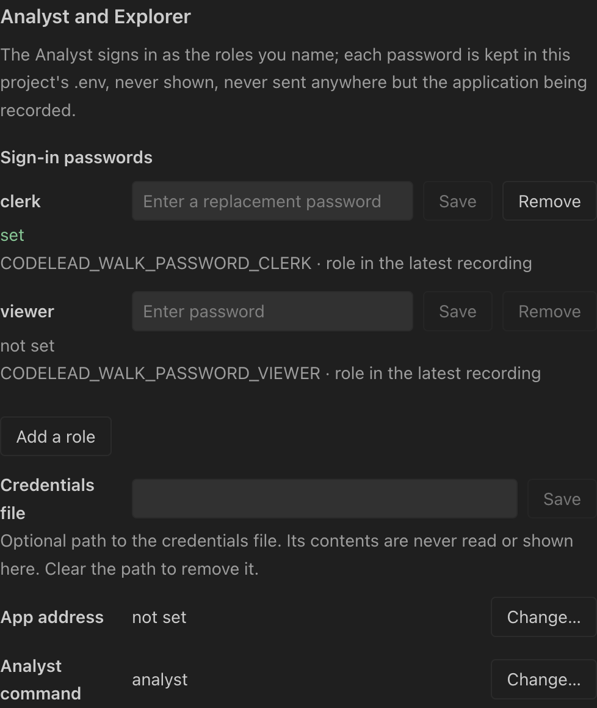

# Settings

**Applies to:** CodeLead for VS Code 0.7.15 and later

The **Settings page** sets a project's models, privacy, build switches, conventions, Analyst passwords and board in one place. The **Settings view** in the side bar shows every setting of the project, and edits some of them row by row. Both write CodeLead's own files: the extension keeps no copy. Each **Save** writes one file, and a value that CodeLead would refuse is refused next to its field, in words.

> [!NOTE]
> **New to this?** CodeLead keeps a project's settings in `.codelead/config.json`, its keys and passwords in `.env`, and its board in `docs/codelead/board/board.json`. The Settings page is a form over these three files. See [Configuration file](../reference/configuration.md).

## Open the Settings page

- The gear in the title bar of the **Settings** view opens the page at the top.
- The gear of the **Projects** view opens it at **Model**. The gear of the **Board** view opens it at **Board**. On the pro plan, the gears of the **Analyst** and **Explorer** views open it at **Analyst and Explorer**.
- **Settings** and the model badge in the [chat](chat.md)'s header, and the model in the status bar, open it at the top.
- In the Command Palette, run **CodeLead: Open CodeLead Settings**.

The tab is named `Settings — <project>`. With several projects, the extension asks "Settings for which project?". The page's header says **CodeLead Settings** and the folder's name. When the environment sets one of CodeLead's override variables, the header warns: "The environment sets CODELEAD_MODEL. It beats these files."


## How a Save works

- Each field keeps your draft until you select its **Save**. Nothing is written while you type.
- The page answers next to the field: "Saved: <what changed>." in green, or the refusal in red, in the writer's own words.
- Then the page reads the files again.
- A key or a password is sent once, written to `.env`, and cleared from the field. The page never receives a key's value: it knows only **set** or **not set**.

## Model

The model that does most of the work: the `default` role. See [Models and roles](../concepts/models-and-roles.md).

| Control | What it does | What it writes |
|---|---|---|
| **Provider** | Chooses the provider: one of the configuration's providers, grouped as Anthropic, OpenAI-compatible and Other. | Nothing by itself. |
| **Add an Anthropic provider…**, **Add an OpenAI-compatible provider…** | Asks a **Name** (one word, such as `openai` or `local`) and, for OpenAI-compatible, an **Address**. **Add provider** adds it. | `.codelead/config.json`: `providers.<name>`. |
| **Address** (OpenAI-compatible only) | The server's web address, for example `http://localhost:1234/v1`. | `.codelead/config.json`: `providers.<name>.baseUrl`. |
| **API key** | A password field. The row says **set** or **not set**. | `.env`: the variable that the provider names in `apiKeyEnv`, such as `ANTHROPIC_API_KEY`. |
| **Model** | A list of the models that the server offers, with **Type a name…** last. A text field when the server gives no list. | `.codelead/config.json`: `modelRoles.default`, and every role that used the same provider and model. |

The model list comes from [`codelead models --provider <name>`](../cli/codelead-models.md). The field's status line says where it stands:

```output
Asking the server for its models…
The server did not answer. Type the model's name.
The key is not set, so the server was not asked. Type the model's name.
From the known list: the server did not answer.
```

An Anthropic provider always offers its four known model ids, even when its server cannot be asked. A model name that the list does not hold is saved, with a warning: `Not in the provider's list; CodeLead will refuse it if the provider does not know it`.

> [!TIP]
> **For experienced users:** a provider that you add at an address that is not this machine counts as remote. CodeLead refuses a remote provider until **Allow remote models** is on. See [Privacy and remote models](../concepts/privacy-and-remote-models.md).

## Model roles

"Each role is one row: the provider, then the model. Save a row to change one role."

| Control | What it does | What it writes |
|---|---|---|
| **Use the same provider and model for every role** | One provider and one model for the seven roles, in one Save. | `.codelead/config.json`: `modelRoles`, all seven roles. |
| A role's row | A provider and a model for one role. A role without an entry says *not set*. | `.codelead/config.json`: `modelRoles.<role>`. |

The seven roles, with the page's own help:

| Role | Help on the page |
|---|---|
| `default` | The main model. Model, above, sets it. |
| `fast` | Quick, small steps. |
| `preflight` | Checks a request before work starts. |
| `architect` | Plans a bigger change. |
| `deep` | Hard changes that need more thought. |
| `critic` | Reviews the work. |
| `repair` | Fixes what failed. |

See [The repair role](../concepts/models-and-roles.md#the-repair-role) and [Use a stronger model for repairs](../how-to/use-a-stronger-model-for-repairs.md).

## Privacy

Three switches, each **on** or **off**. See [Privacy and remote models](../concepts/privacy-and-remote-models.md).

| Switch | Help on the page | What it writes |
|---|---|---|
| **Allow remote models** | Lets CodeLead use a model on the internet. | `.codelead/config.json`: `privacy.allowRemoteModels` |
| **Ask before sending code** | Asks you before your code goes to a remote model. | `.codelead/config.json`: `privacy.confirmBeforeSendingRepoContextToRemote` |
| **Leave out secret files** | Keeps files such as .env out of what is sent. | `.codelead/config.json`: `privacy.redactSensitiveFiles`. The switch is stored and not used. Files such as `.env` stay out of what is sent whatever its value, because CodeLead's ignore rules go by the file's name. |

> [!IMPORTANT]
> With a remote model in a role and **Allow remote models** off, the chat does not start. It says why, and names the setting. Turn the switch on only when the code's owner agrees.

## Greenfield builds

Two switches for a new app's build. Both put the `repair` role's model on the end of the build. Both are off by default, and both need the `repair` role set in **Model roles**. Without it, the build runs as if the switch were off. See [New apps: steps, increments and the run report](../concepts/new-apps.md).

| Switch | What it does | What it writes |
|---|---|---|
| **Polish on the repair model** | The page's help: "The plan's last increment and the polish steps used by Create an app run on the repair role's model. Needs the repair role set above." | `.codelead/config.json`: `greenfield.polishOnRepairRole` |
| **Review pass after the build** | When every step is done, the repair role's model reviews the app once for code quality and UX, and makes one change set through the usual checks. | `.codelead/config.json`: `greenfield.reviewPassAfterBuild` |

When the review pass does not land, the build still counts as complete, and the chat says why.

## Conventions

The rules that every change follows. See [Conventions](../concepts/conventions.md) and [Write your conventions](../how-to/write-conventions.md).

| Part | What it shows | Button | What the button does |
|---|---|---|---|
| **Your rules** | The rules file that CodeLead reads, or "No rules file yet". | **Edit** | Opens the rules file in the editor. |
| | | **Create** | Writes `.codelead/CONVENTIONS.md` from a short starter, and opens it. |
| **What the code does** | "12 rules, written <time>", or "Not read yet". | **Read the code** | Runs [`codelead conventions`](../cli/codelead-conventions.md) in the terminal **CodeLead: conventions**. It writes `.codelead/conventions.json`. |
| | | **Refresh** | Reads the two files again. |

"Rules you write outrank what the code shows. Both go into every change CodeLead makes."

**Create** writes this starter. A line moved out of the comment becomes a rule:

```markdown
# Conventions

CodeLead reads this file and applies it to every change it makes. Write each rule in plain words, one per line.

<!-- Examples. Move a line out of this comment to make it a rule:
- Tests sit beside the code they test.
- No default exports.
- Errors are typed, never strings.
-->
```

- **Which file is "your rules".** CodeLead reads the first file of this list that holds text:

  ```text
  .codelead/CONVENTIONS.md
  CONVENTIONS.md
  STYLEGUIDE.md
  STYLE_GUIDE.md
  CODING_GUIDELINES.md
  CODING-GUIDELINES.md
  docs/STYLEGUIDE.md
  docs/CONVENTIONS.md
  CONTRIBUTING.md
  .github/CONTRIBUTING.md
  ```
- **Create never replaces a file.** When a rules file exists, **Create** opens it instead.
- **Read the code** is off in an untrusted folder: "This folder is not trusted. Trust it first, then CodeLead can read the code."

## Analyst and Explorer

The sign-in passwords and the settings that only the Analyst and the Explorer need. See [The Analyst view](analyst-view.md) and [Passwords](../analyst/passwords.md).

On the free plan, the section shows only one line: "Analyst and Explorer are in CodeLead's Pro plan". The controls below appear on the pro plan. See [Licence and plans](../concepts/licence-and-plans.md).



| Control | What it does | What it writes |
|---|---|---|
| A role's password, **Save** | Saves the password of one role. The row says **set** or **not set**, and names its variable. | `.env`: `CODELEAD_WALK_PASSWORD_<ROLE>` |
| **Remove** | Deletes the role's password. | `.env`: removes the variable. |
| **Add a role** | Names a new role. A role's name starts with a letter (A to Z, a to z), then letters, digits or underscores: the Analyst's one rule. | Nothing until you save its password. |
| **Credentials file**, **Save** | The path of a credentials file. Clear the path to remove it. The page never reads the file. | `.env`: `CODELEAD_WALK_CREDENTIALS` |
| **App address**, **Change…** | The application's address that Record and Explore offer first. | VS Code's storage for this folder, not a file of the project. |
| **Analyst command**, **Change…** | Shows the command that the extension resolves and runs, or the reason when it finds none. An empty setting, the default, uses CodeLead's own Analyst, `codelead analyst`. **Change…** opens the VS Code setting. | The VS Code setting `codelead.analystCommand`. |

The roles of the latest recording appear in the list by themselves, marked "role in the latest recording". A row says "the environment overrides .env" when the variable is also set in the environment.

### Windows sign-in

There is no separate section for Windows sign-in. It is a choice in the questions of **Record a journey** and **Explore an application**: **Integrated**. With it, the browser signs in with this computer's own session, and no password is needed. To sign in as another account, save a password for the role `alpha`: it is written as `CODELEAD_WALK_PASSWORD_ALPHA`. See [The Analyst view](analyst-view.md#windows-sign-in).

## Board

The people of the project's board, and how often agents check it. See [Pinboard](../pinboard/index.md).

| Control | What it does | What it writes |
|---|---|---|
| **People** | Each participant: the name, the id and the kind. **Remove** asks "Remove <name>?" with **Yes, remove** and **Keep**. | `docs/codelead/board/board.json`: `participants` |
| **Add a person** | A **Name** and an **Id**. The id follows the name until you type one: one word, used by commands and the board. | `docs/codelead/board/board.json`: `participants` |
| **Check every … minutes** | How often an agent checks the board. The default is 30. | `docs/codelead/board/board.json`: `check.intervalMinutes` |

A project with no board says "This project has no board yet." See [The Board view](board-view.md).

## Where these live

The last section lists the paths of the three files: **Settings** (`.codelead/config.json`), **Keys** (`.env`) and **Board** (`docs/codelead/board/board.json`). "Each Save writes one of these files."

## The Settings view

The **Settings** view in the side bar shows every setting of the project, in sections. It shows more than the page: the strategies, the context limits, the call budgets, the licence and the overrides.

| Section | What its rows show | Editable with the pencil |
|---|---|---|
| **Providers** | Each provider: its type, local or remote, its address, and `key: set` or `key: not set`. The tooltip names the key's variable and where it comes from: the environment, `.env`, or nowhere. | Yes: the type, the base URL, the key variable, remote or local, set the key, remove the key. |
| **Model roles** | Each role: its provider and model, or *(not set)*. | Yes: a provider, then a model from the server's list. |
| **Strategies** | Which role answers each [strategy](../concepts/strategies.md): `fast`, `clarify`, `architect`, `deep`. | Yes. |
| **Privacy** | The three switches: `on`, `off` or *(not set)*. | Yes. |
| **Context** | `maxFiles`, `maxSnippetCharsPerFile`, `includeTests`, `includePackageJson`. | Yes. |
| **Call budgets** | The profile, and each role's limits. Only when the configuration has them. | The profile: `fast`, `balanced` or `quality`. |
| **Board** | The participants, the columns and the check interval. | The participants and the interval. |
| **Licence** | The holder, the project, the seats and the term. | No. |
| **Overrides** | The environment variables that beat the files, such as `CODELEAD_MODEL`. | No. |

A click on a row that the pencil edits opens its dialog. A click on any other row opens its file. A key is asked in a hidden box, and is never shown again. A refused value shows a message with the reason.

## Examples

- Connect a local model server, such as LM Studio:

  1. In **Model**, choose the provider `lmstudio`.
  2. Keep **Address** `http://localhost:1234/v1`, or type your server's address and select **Save**.
  3. Choose a model in **Model**, and select **Save**.

  <!-- described, not captured -->
  ```output
  Saved: default and fast, preflight, architect, deep, critic: lmstudio · qwen/qwen3.6-35b-a3b.
  ```

  The roles that used the same provider and model follow the default.

- Use a remote model for repairs only, while every other role stays local:

  1. In **Model roles**, on the row `repair`, choose the provider `anthropic` and the model `claude-opus-5-5`. Select **Save**.
  2. In **Model**, choose `anthropic`, paste the key in **API key**, and select **Save**.
  3. In **Privacy**, turn on **Allow remote models**.

  `.codelead/config.json` then holds:

  ```json
  "modelRoles": {
    "repair": { "provider": "anthropic", "model": "claude-opus-5-5" }
  },
  "privacy": { "allowRemoteModels": true }
  ```

  The key is in `.env` as `ANTHROPIC_API_KEY`. The page shows only **set**.

- Turn on the review pass of a new app's build. In **Greenfield builds**, turn on **Review pass after the build**:

  <!-- described, not captured -->
  ```output
  Saved: reviewPassAfterBuild: on.
  ```

  ```json
  "greenfield": { "reviewPassAfterBuild": true }
  ```

- An address without its scheme is refused. In **Address**, type `localhost:1234` and select **Save**:

  <!-- described, not captured -->
  ```output
  The base URL must start with http:// or https://.
  ```

## Files

| File | What the Settings page and view write in it |
|---|---|
| `.codelead/config.json` | The providers, the model roles, the privacy switches, the `greenfield` switches, and, from the view, the strategies, the context and the call budget profile. Other keys stay as they are. |
| `.env` | The providers' keys, `CODELEAD_WALK_PASSWORD_<ROLE>` and `CODELEAD_WALK_CREDENTIALS`. Other lines stay byte for byte. |
| `docs/codelead/board/board.json` | The participants and `check.intervalMinutes`. |
| `.codelead/CONVENTIONS.md` | Written once by **Create**, when no rules file exists. |
| `.codelead/conventions.json` | Written by `codelead conventions` when you select **Read the code**. |

The VS Code settings of the extension, such as `codelead.command`, are in VS Code's own settings. See [Commands and settings of the extension](commands.md).

## See also

- [Models and roles](../concepts/models-and-roles.md)
- [Privacy and remote models](../concepts/privacy-and-remote-models.md)
- [Conventions](../concepts/conventions.md)
- [Configuration file](../reference/configuration.md)
- [Set up local models](../how-to/set-up-local-models.md) and [Set up remote models](../how-to/set-up-remote-models.md)
- [Use a stronger model for repairs](../how-to/use-a-stronger-model-for-repairs.md)
- [Commands and settings of the extension](commands.md)
