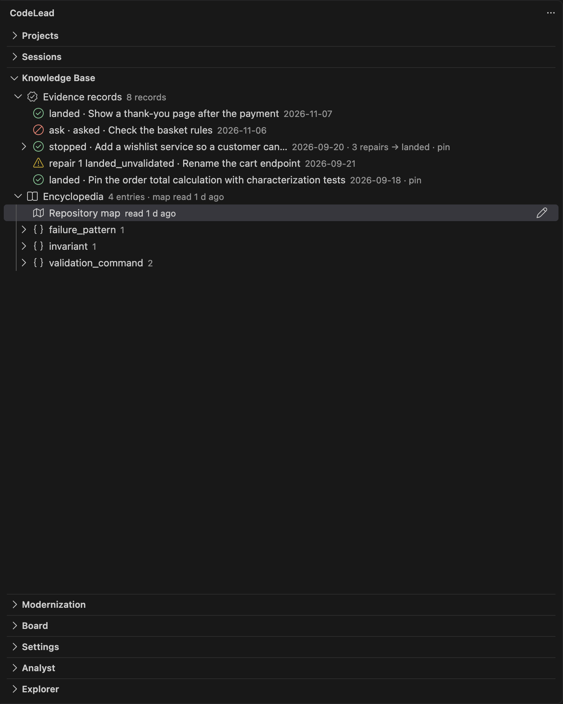
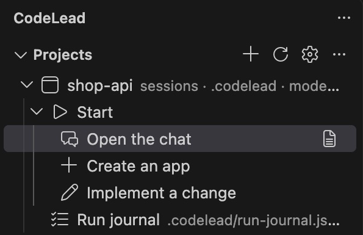
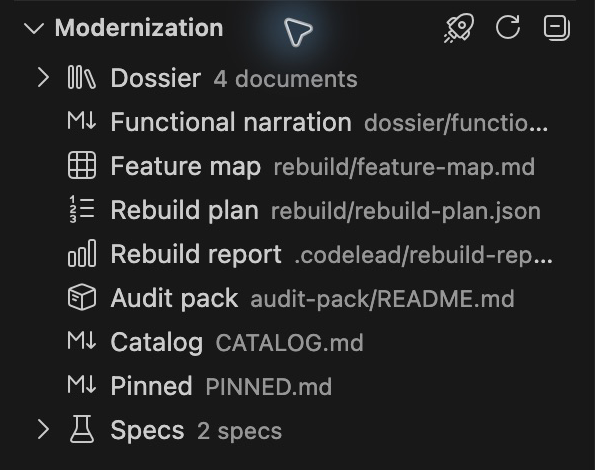
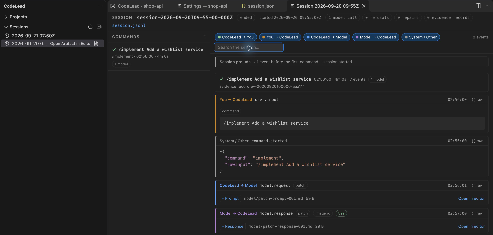
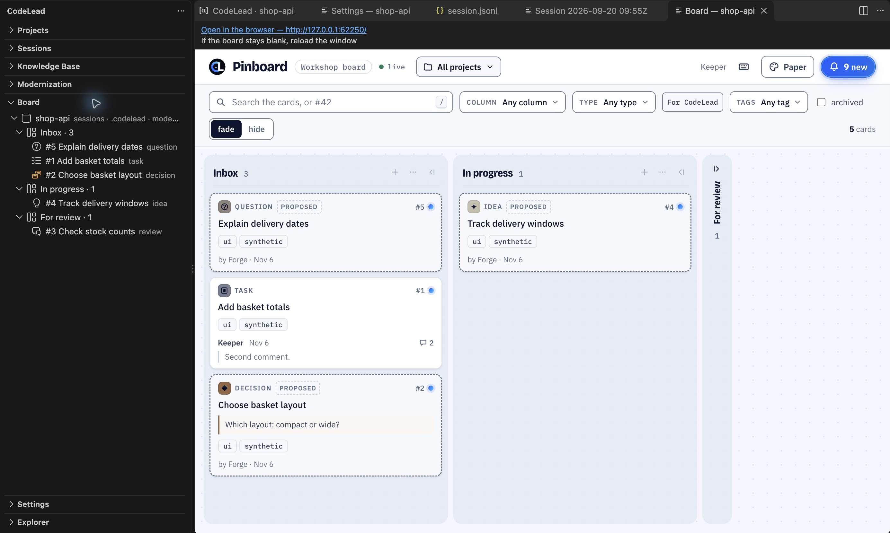
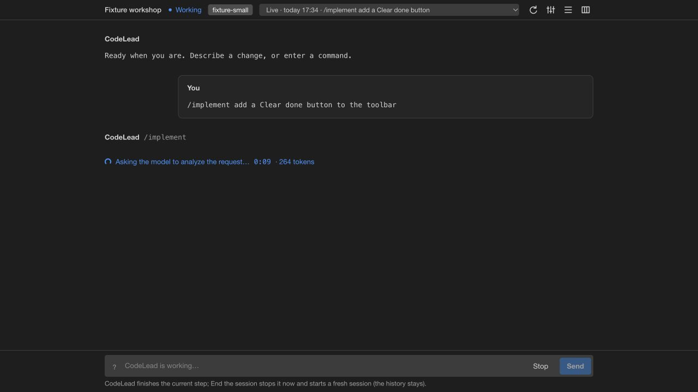

# A tour of the extension

CodeLead for VS Code has three kinds of parts. **Views** in the side bar list what CodeLead knows about a project. **Tabs** in the editor area show one thing in full: the chat, a session, a page of settings. **The status bar, the output panels and the terminals** show what runs now. This page shows each part once and links to its own page.

**In short**
- The side bar has eight views: Projects, Sessions, Knowledge base, Modernization, Board, Settings, Analyst and Explorer.
- A click on a row opens a tab: the chat, the Session tab, an evidence record, the board page, the Settings page, a recording.
- The status bar shows the model in use and the board's count. Each one opens its page with a click.
- Commands that run for a long time write to the output panel **CodeLead**, or to a terminal that you can read.

## Why the extension looks like this

CodeLead writes files: session logs, evidence records, a knowledge base, a board. A person needs to find them without a terminal. The views list those files, and the tabs render them. The buttons run the same `codelead` commands that a terminal runs, so that the result is the same everywhere. See [How CodeLead works](../concepts/how-codelead-works.md).

## The views

Select the **CodeLead** icon in the activity bar. The side bar shows the views in this order:

| View | What it lists | A click on a row opens | Its title bar |
|---|---|---|---|
| [Projects](projects-view.md) | The folders that hold CodeLead files, each with a **Start** row and the run journal. | The project's chat. | **+** (Create an app), refresh, gear (model settings), and a **…** menu of actions. |
| [Sessions](sessions-view.md) | The session logs of each project, newest first. | The Session tab. | Refresh. |
| [Knowledge base](knowledge-base-view.md) | **Evidence records** and the **Encyclopedia**, with the repository map. | The record's page, the board on a card, the map, or the knowledge ledger. | Refresh. |
| [Modernization](modernization-view.md) | The dossier, the rebuild plan and report, the audit pack, the project documents and the specs. | The document's page. | Rocket (Modernize this application), refresh. |
| [Board](board-view.md) | The board's columns and cards. | The board page, at the card. | Refresh, gear (board settings). |
| [Settings](settings.md) | The settings of each project, in sections. | The file, or an edit dialog. | Gear (the Settings page), refresh. |
| [Analyst](analyst-view.md) | The recordings and the drafts of journeys. | The recording page, or the file. | **+** (Record a journey), refresh, gear. |
| [Explorer](explorer-view.md) | The explorations of a running application. | The site map, the forms or the stories. | **+** (Explore an application), refresh, gear. |

On the free plan, the Analyst and Explorer views show one row with a lock. The Modernization view shows a lock row above the specs. See [Licence and plans](../concepts/licence-and-plans.md).

> [!NOTE]
> **New to this?** Each view has its own title bar. Its buttons appear when you move the pointer over the view. The **…** at the right holds the actions that have no button.

The Projects view, with the **Start** row and the run journal:

The Modernization view on the pro plan:

## The tabs

The views open these tabs in the editor area:

| Tab | Title | Opens from | Page |
|---|---|---|---|
| The chat | `CodeLead · <project>` | A project in Projects, **Start** > **Open the chat**, **Create an app**, **Implement a change**. | [The chat](chat.md) |
| The Session tab | `Session <time>` | A session in Sessions, **Session log** in the chat. | [The Sessions view](sessions-view.md) |
| An evidence record | The record's id | A record in Knowledge base. | [The Knowledge base view](knowledge-base-view.md) |
| The knowledge ledger | `Knowledge — <project>` | An entry of the encyclopedia. | [The Knowledge base view](knowledge-base-view.md) |
| The run journal | `Run journal — <project>` | **Run journal** in Projects. | [The Projects view](projects-view.md) |
| A modernization page | The document's title | A document in Modernization. | [The Modernization view](modernization-view.md) |
| The Modernize wizard | `Modernize · <project>` | The rocket in Modernization. | [The Modernize wizard](modernize-wizard.md) |
| The board | `Board — <project>` | A column or a card in Board, the board's status bar item. | [The Board view](board-view.md) |
| The Settings page | `Settings — <project>` | A gear in a view's title bar, **Settings** in the chat. | [Settings](settings.md) |
| A recording | `Recording · <time>` | A recording in Analyst or Explorer. | [The Analyst view](analyst-view.md) |
| Confirm | `Confirm · <folder>` | **Confirm** on a draft in Analyst. | [The Analyst view](analyst-view.md) |

The Sessions view beside the Session tab of one session:

The Board view beside the board page:

The chat in an editor tab is the main way to work. It runs a CodeLead session for one project, as [`codelead interactive`](../cli/codelead-interactive.md) does in a terminal. Its questions are buttons, and every command ends with a result message.

## The status bar

The extension adds two items to the status bar at the bottom of the window:

- **The model.** A robot icon with the provider and the model of the default role, for example `lmstudio · qwen/qwen3.6-35b-a3b`. The tooltip says "CodeLead model: click to change". A click opens the Settings page.
- **The board.** A speech bubble with two numbers: the cards that have something new for you, and the cards that name you, as `3 · @1`. A click opens the board. The tooltip lists the projects and up to five card titles. A dash means that the board check failed: the tooltip says why.

The board item shows only when a project of the window has a board. See [The Board view](board-view.md).

## The output panels and the terminals

Long work runs where you can read it.

| Name | Kind | What writes there |
|---|---|---|
| **CodeLead** | Output panel | Initialize, **Check the specs**, **Write the spec report**, **Read the repository again**, and the chat's own log lines and CodeLead's error output. |
| **CodeLead Analyst** | Output panel | The Analyst's commands: draft, check, rules, facts, and the Explorer's run. |
| **CodeLead** | Terminal | **Create an app** and **Implement a change**, when the setting `codelead.runIn` is `terminal`. |
| **CodeLead: modernize** | Terminal | Every command of the Modernize wizard. You answer its questions in this terminal. |
| **CodeLead: conventions** | Terminal | **Read the code** on the Settings page. |
| **CodeLead Analyst: record**, **CodeLead Analyst: replay** | Terminal | **Record a journey** and **Replay**. |

To see an output panel, select **View** > **Output**, then choose the name in the list at the right of the panel.

## What it is not

- **Not a second CodeLead.** Every button runs the `codelead` command of the setting `codelead.command`. The extension never calls a model itself.
- **Not a store.** The views read the project's files. Delete a file, and its row goes. Uninstall the extension, and the files stay.
- **Not automatic.** The extension never initializes a folder by itself, and never sends a request without your click or your Enter.

## Related content

- [Install the extension](install.md)
- [The chat](chat.md)
- [Commands and settings of the extension](commands.md)
- [Quickstart: CodeLead in VS Code](../get-started/quickstart-vscode.md)
- [Licence and plans](../concepts/licence-and-plans.md)
- [Sessions](../concepts/sessions.md)
- [Glossary](../concepts/glossary.md)
