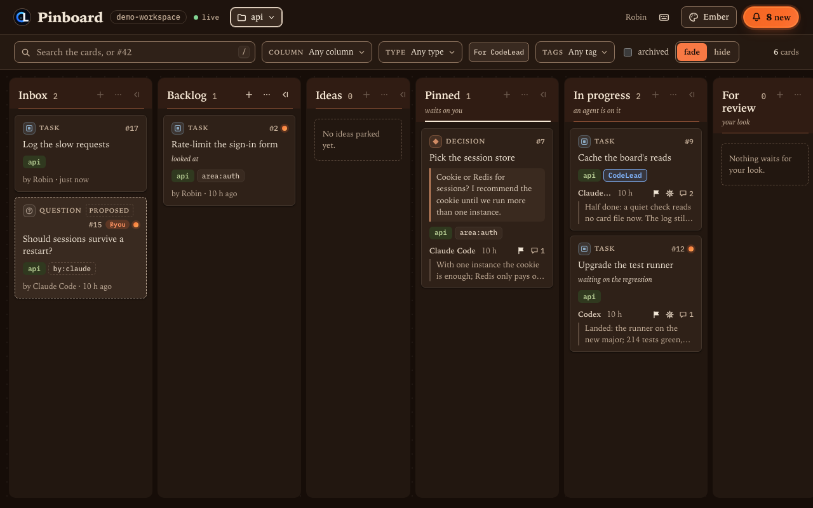

# Pinboard

Pinboard is the board between you and your coding agents. It holds **cards** (one piece of work or one question each), and every card has a thread of comments. The board is a set of plain files in your repository, so you, the page and every agent read and write the same thing.

**In short**
- You work on the board's **page**: you write cards, answer threads, drag cards between columns and record decisions.
- The coding agent runs the board's **commands** itself. A file in the board folder, `AGENTS.md`, teaches it the rules.
- The board never calls a model and never runs code. Every write goes through one set of rules, and a refused write changes nothing.
- CodeLead gives the board as [`codelead board`](../cli/codelead-board.md). A card tagged `for:codelead` is work for CodeLead itself.

## Who it is for

- **You are new to coding agents.** The board keeps what an agent asks you, and what you ask it, in one place. You do not lose a question in a long chat. Start with [Use the board](use-the-board.md).
- **You already use coding agents.** You run Claude Code, Codex or another agent, maybe more than one. The board gives them a shared list of work with rules they cannot break. Start with [Work with agents](work-with-agents.md).
- **You lead a team.** Every change to a card is a line in an event log. The cards travel with the code in git. Start with [Files and events](files-and-events.md) and [Rules for agents](rules-for-agents.md).

> [!NOTE]
> **New to this?** A *coding agent* is an AI tool that reads and edits code for you, such as Claude Code or Codex. A *board* is a set of columns, like Backlog or Done, with a card for each piece of work.

## Three ways in

All three read and write the same files, through the same rules.

1. **The page in VS Code.** The [Board view](../extension/board-view.md) of CodeLead for VS Code lists the columns and opens the page in a tab. The extension starts and stops the page's local server for you. Most people start here.
2. **The page in a browser.** Run [`codelead board serve`](cli/board-serve.md) in the repository, then open the address that it prints, for example `http://127.0.0.1:7414/`. The page answers only on your machine.
3. **The commands.** The agent uses [`codelead board check`](cli/board-check.md), [`reply`](cli/board-reply.md), [`new`](cli/board-new.md), [`move`](cli/board-move.md) and the others. You can use them too, but you do not need to. See [Board commands](cli/index.md).

> [!TIP]
> **For experienced users:** a person types two commands in the life of a board: [`codelead board init`](cli/board-init.md) once, and `codelead board serve` to start the page. Everything else happens on the page or inside the agent's session.

## Licence

Pinboard is open source, under the MIT licence. You can use it, change it and ship it with your own work. Keep the copyright notice.

## Get started

- [Set up a board and give it to an agent](work-with-agents.md)
- [Use the board](use-the-board.md)
- [Install CodeLead](../get-started/install.md)

## Tutorials

- [Work with agents on the board](../tutorials/work-with-agents-on-the-board.md)

## How-to guides

- [Use the board](use-the-board.md)
- [Choose a project, a theme and change several cards](projects-themes-and-bulk.md)
- [Work with agents](work-with-agents.md)

## Concepts

- [Cards, columns and participants](concepts.md)
- [Rules for agents](rules-for-agents.md)
- [The Board view in VS Code](../extension/board-view.md)

## Reference

- [Board commands](cli/index.md)
- [Files and events](files-and-events.md)
- [`codelead board`](../cli/codelead-board.md)
- [Glossary](../concepts/glossary.md)
