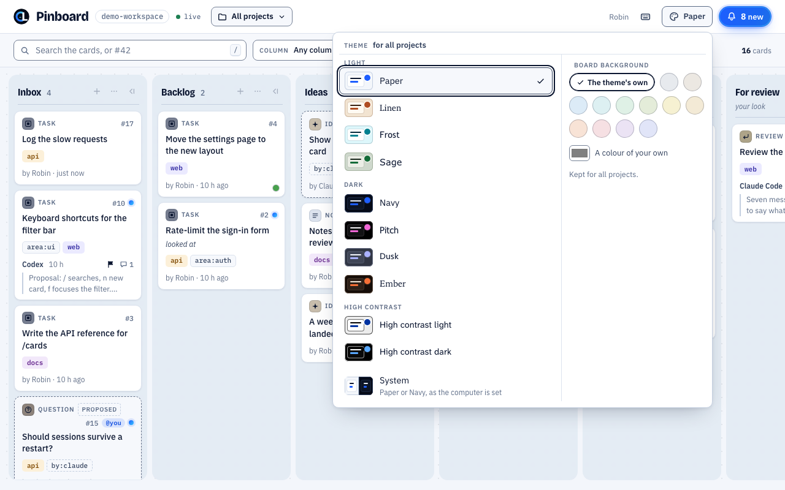
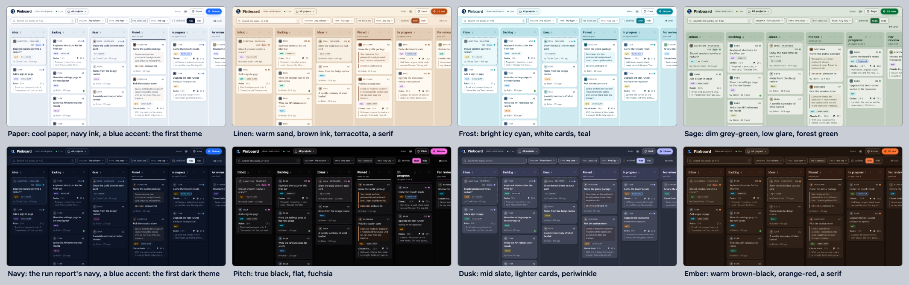
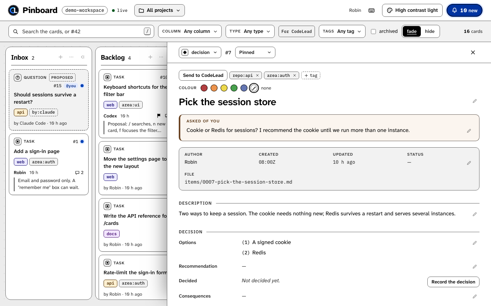
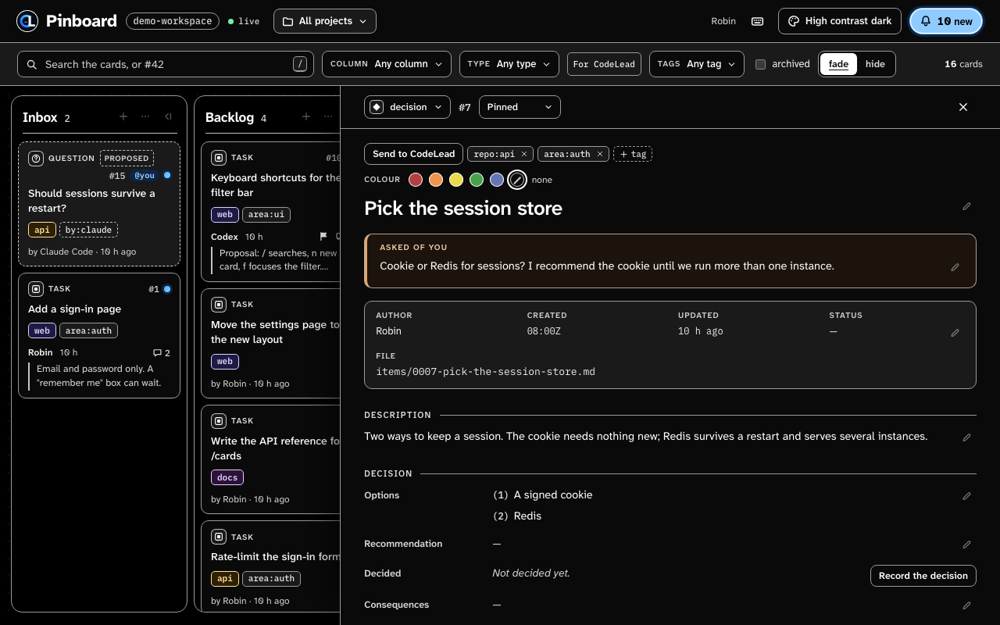
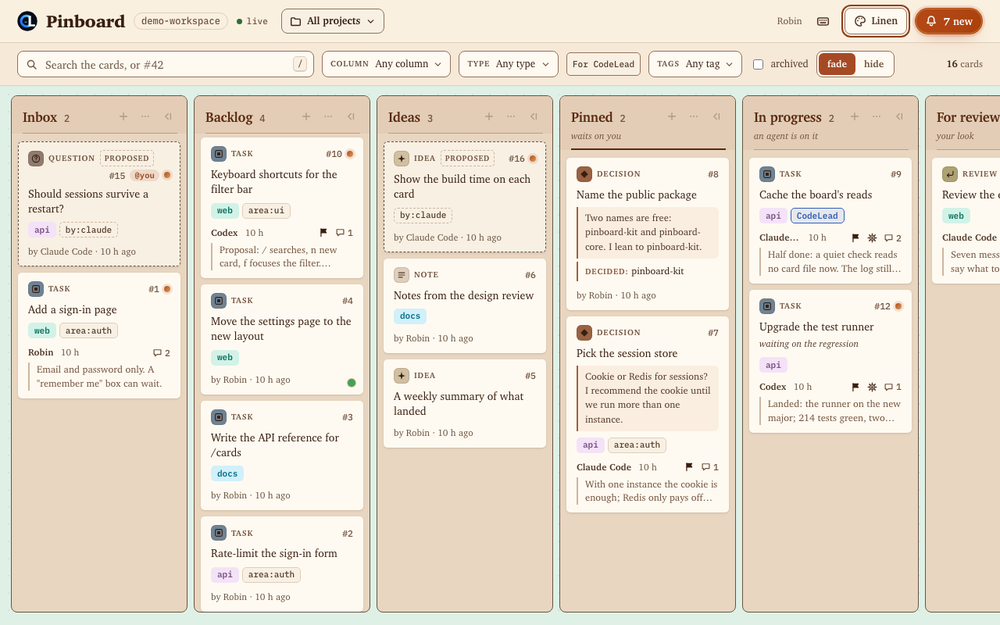
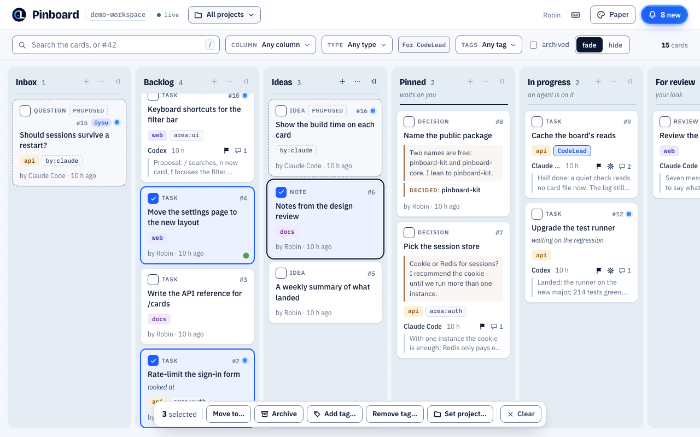
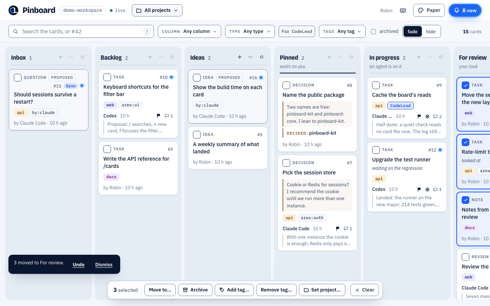

# Projects, themes and bulk operations

This page shows three parts of the board's page. They are the project selector, the themes with the board background, and the bulk bar for several cards. Your theme choices are kept per project, in a file on your machine.

**In short**
- A project is a tag on a card: `repo:<name>`. The selector at the left of the top bar shows one project's cards.
- The palette button offers ten themes, **System**, and a background for the board. A choice is kept for the project shown.
- The choices live in `<board>/.local/preferences.json`, which git ignores.
- ⌘-click (Ctrl-click on Windows and Linux) picks cards. The bar at the bottom moves, archives, tags or sets the project of every picked card.

## Before you begin

- The board's page is open. See [Use the board](use-the-board.md#open-the-page).
- You know what a tag is. See [Tags](concepts.md#tags).

## Show one project's cards

A board can hold the cards of several repositories, or of several parts of one. A card belongs to a project when it has the tag `repo:<name>`, such as `repo:webapp`.

1. Select the folder button at the left of the top bar. It says **All projects** at first.
2. Choose a project. Each line shows how many of its cards are open: not archived, and not in the last column.

The whole board then shows only that project's cards: the columns, their counts and the search. **No project** shows the cards without a `repo:` tag. It appears when some cards have a project and some do not.

The page's address keeps the choice, such as `?project=webapp`, so a bookmark opens on the project. When the address names no project, the page opens on the project that it showed last. A card that you write while a project is shown gets its tag. You can remove the tag in the form.

> [!NOTE]
> **New to this?** The selector does not change any card. It only changes what the page shows. To put a card in a project, add its `repo:` tag, or use **Set project…** in the bulk bar.

## Choose a theme

Select the palette button in the top bar. It shows the name of the theme in use, such as **Paper**. The menu lists the themes in three groups, each with a small sample:



| Theme | Kind | What sets it apart | Font |
|---|---|---|---|
| Paper | Light | Cool paper, navy ink, a blue accent. The first theme. | IBM Plex Sans |
| Linen | Light | Warm sand, brown ink, terracotta, a serif. | Charter |
| Frost | Light | Bright icy cyan, white cards, teal. | Trebuchet MS |
| Sage | Light | Dim grey-green, low glare, forest green. | Verdana |
| Navy | Dark | The run report's navy, a blue accent. The first dark theme. | IBM Plex Sans |
| Pitch | Dark | True black, flat, fuchsia. | Tahoma |
| Dusk | Dark | Mid slate, lighter cards, periwinkle. | Seravek |
| Ember | Dark | Warm brown-black, orange-red, a serif. | Iowan Old Style |
| High contrast light | High contrast | Black on white, text at 7:1. | Atkinson Hyperlegible Next |
| High contrast dark | High contrast | White on black, text at 7:1. | Atkinson Hyperlegible Next |

**System** follows your computer. It shows the light theme that you picked last by day, and the dark theme that you picked last by night. The default is System, with Paper and Navy.

A choice applies at once. Arrow keys move through the list, Enter picks, and Esc closes the menu.

The eight colour themes, side by side:



The two high contrast themes, with a decision card open:





> [!TIP]
> **For experienced users:** the text is the same size in every theme. Text reads at 4.5:1 or more on its ground, and at 7:1 in the high contrast themes. The fonts come with the package, so the page loads nothing from the network.

## Choose a board background

The same menu has **Board background** on the right:

- **The theme's own**: the default.
- **Twelve colours** that suit the theme: light ones for a light theme, dark ones for a dark theme.
- **A colour of your own**: any colour. The text on the board switches to stay readable.

Your colour is the backdrop only. Each column keeps the theme's surface, with its title and its cards.



## Keep a theme for one project

A choice is kept for the project that the page shows. The menu says so at the top, as "for all projects" or "for webapp".

1. Choose a project in the selector, for example **webapp**.
2. Open the theme menu and choose **Ember**.

Next time, `webapp` opens in Ember. The other projects keep the default. **All projects** saves the default. **Use the default**, in the menu, forgets a project's own choice.

The page keeps these choices in the board folder, in `.local/preferences.json`. The page in VS Code and the page in a browser read the same file. In this real file, `webapp` keeps Ember and a background of its own. The default is System, with Linen by day:

```json
{
  "schema": "pinboard.preferences/1",
  "default": { "theme": "system", "lightTheme": "linen", "darkTheme": "navy" },
  "projects": { "webapp": { "theme": "ember", "darkTheme": "ember", "background": "#2a3b4c" } },
  "lastProject": "webapp"
}
```

## Change several cards at once

### Pick the cards

- ⌘-click a card on macOS, or Ctrl-click on Windows and Linux. The card shows a ticked box.
- Shift-click picks every card between it and the last card that you picked in that column.
- Press `x` to pick the card that the keyboard is on.
- A column's **⋯** menu has **Select all in this column**.
- Esc clears the pick.

### Use the bulk bar

The bar at the bottom says how many cards are picked, such as **3 selected**:



| Button | What it does |
|---|---|
| **Move to…** | Moves every picked card to one column. The cards keep their order there. Pinned and Done say "yours: agents never move cards here". |
| **Archive** | Archives every picked card. They leave the board and stay in their files. |
| **Add tag…** | Adds one tag to every picked card. |
| **Remove tag…** | Removes one tag. The dialog lists the tags of the picked cards, with how many carry each. |
| **Set project…** | Adds a project's tag: an existing project, or a new name. Tick **Replace their other project (remove its tag)** to take off their other `repo:` tag. |
| **Clear** | Clears the pick. |

Each button asks once, in a dialog that names how many cards it changes. Then a message says what happened, card by card, with **Undo**:



When a card is refused, the message says why, for example "6 archived, 1 refused: #42 changed since you read it". The other cards keep their change. **Undo** puts back what the change did.

You can also drag one picked card: the other picked cards come with it, in their order.

### The same with commands

Each bulk change is also a command, with several ids:

```console
codelead board move 1 2 --to done --as sam
```

```output
Moved to Done (1 changed, 1 unchanged):
  #1 from For review
  #2 already in Done; nothing was written
```

```console
codelead board set 5 6 --as sam --tag area:catalog
```

```output
Changed (2 changed):
  #5 tagged it area:catalog
  #6 tagged it area:catalog
```

See [`move`](cli/board-move.md), [`archive`](cli/board-archive.md), [`unarchive`](cli/board-unarchive.md) and [`set`](cli/board-set.md).

## Details

- **Open cards.** A project's count leaves out archived cards and the cards in the board's last column (Done on a new board).
- **A project's name.** A new project's name is one word of letters, digits, `.`, `-` and `_`. It has up to 64 characters, and starts with a letter or a digit.
- **Limits.** One bulk change names at most 500 cards. Each card is written on its own, with its own rules and events. A refusal of one card leaves the others changed.
- **The preferences file.** The page's process checks it before it writes it. The file holds 64 KB and 500 projects at most. A project's name holds no secret, machine path or private name. A wrong file is refused in words, for example: `Refused: the preferences cannot be kept: default.theme must be one of paper, linen, frost, sage, navy, pitch, dusk, ember, contrast-light, contrast-dark, system, and is "purple". Nothing was written.`
- **Git.** The board folder's `.gitignore` lists `.local/`, so the choices stay on your machine. See [Files and events](files-and-events.md#the-local-folder).

## Check that it worked

- The theme button shows the theme's name, and the menu says "Kept for webapp: its own theme".
- The bulk message says how many cards changed. Run [`codelead board list`](cli/board-list.md) to see the cards in their new columns.

## See also

- [Use the board](use-the-board.md)
- [Cards, columns and participants](concepts.md)
- [Files and events](files-and-events.md)
- [`codelead board move`](cli/board-move.md), [`codelead board set`](cli/board-set.md), [`codelead board archive`](cli/board-archive.md)
- [The Board view](../extension/board-view.md)
