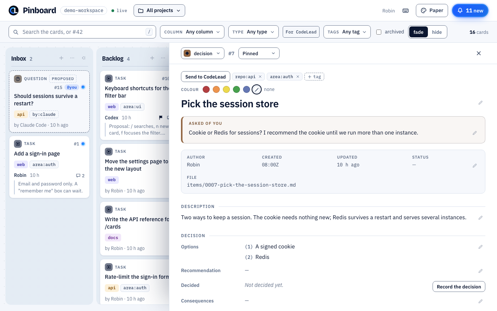
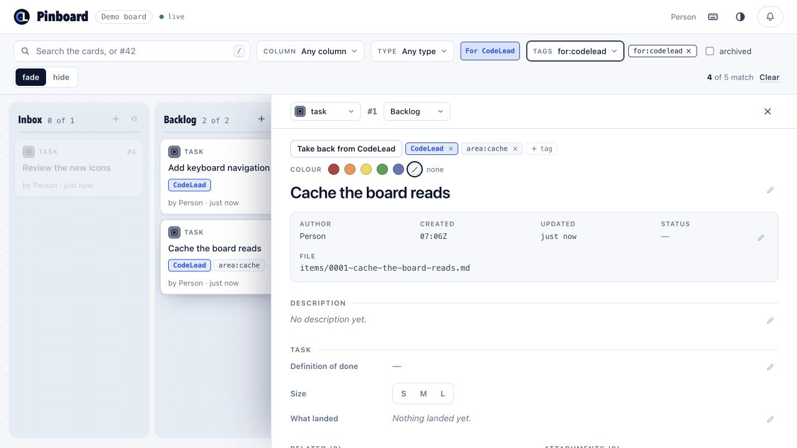

# Use the board

This page shows the person's side of the board: the page. You write cards, answer the agents, move cards and record decisions there. The agents use the commands; you see what they did on the same page.

**In short**
- Open the page in VS Code or with `codelead board serve`. It shows changes to the files as they happen.
- Press `n` to write a card, open a card to answer its thread, and drag a card to move it.
- A decision card shows its question on its face. **Record the decision** writes your answer.
- The bell shows what changed since you last looked. Cards marked **@you** name you.

## Before you begin

- The repository has a board. If it does not, run [`codelead board init`](cli/board-init.md) in it, or select **Set up the board in this folder** in the [Board view](../extension/board-view.md).
- You know the board's ideas: cards, columns, threads and decisions. See [Cards, columns and participants](concepts.md).
- You do not need to know any command. The page does everything on this page.

> [!NOTE]
> **New to this?** The page writes the same files that the commands write, under the same rules. When the page refuses something, it shows the reason in words, and nothing changes.

## Open the page

Choose one way:

- **In VS Code**: select a column or a card in the **Board** view. The page opens in a tab named `Board — <project>`.
- **In a browser**: run this command in the repository, and leave it running:

  ```console
  codelead board serve --open
  ```

  ```output
  Pinboard: http://127.0.0.1:7414/
  The board in docs/codelead/board, as Sam. The page writes the board's files through the same rules as these commands; Ctrl+C stops it.
  ```

  `--open` opens the address in your browser. Without it, open the address yourself.

The top bar shows the board's name and a dot that says **live**. **offline** means that the page's process does not answer: start `codelead board serve` again, and the page reconnects. At the right, the bar shows your name, the keyboard shortcuts, the theme and the bell. The page always writes as the board's first person in `board.json`.

## Write a card

1. Press `n`, or select **+** at the top of a column. A small form opens in that column. `n` opens it in Inbox.
2. Choose the type: task, question, decision, idea, review or note.
3. Type a title, and a description in markdown if you want. Type `@` in the description to address someone, such as `@claude`.
4. Select **Create card**, or press ⌘↵ (Ctrl+Enter on Windows and Linux). Esc cancels.

The card gets the next number, such as `#8`, and lands in that column. A card that you write on the page is not tagged `by:<you>`: that tag marks an agent's proposals. When a project is shown, the new card gets its `repo:` tag; you can remove it in the form.

## Read and answer a card

1. Select a card, or move to it with the arrow keys and press Enter. The card opens in a panel over the board.
2. Read its description, its fields, its related cards and its thread.
3. Write your answer in the box under the thread. Choose **Write**, **Preview** or **Side by side** to see the markdown formatted.
4. Select **Comment**, or press ⌘↵. To answer and move the card in one step, select **Comment & move** and choose the column.

Every field of the panel saves on its own: the title, the description, the status, the tags, the colour, the type and the type's fields. **+ Relate a card** adds a relation. **+ Attach a file** adds a path, such as `docs/plan.md:40-60`, or `<repository>:<path>` for another repository. A path to a file on this machine opens in VS Code.

A related card opens on top of the first one. **Back** returns to the card below. Esc closes the top card.

> [!IMPORTANT]
> When a card changed after you opened it, a save is refused, for example "changed since you read it". Read the card again, then redo your change. Nothing of yours overwrites what an agent wrote meanwhile.

## Move a card

- **Drag** the card to another column, or to another place in its column. The page keeps the place where you dropped it.
- **In the panel**, choose a column in the list beside the card's number.
- **With the keyboard**, press `m`, then the column's number: `1` for Inbox, `4` for Pinned, `7` for Done.

**Pinned** and **Done** are yours alone. An agent never moves a card into them. Pin a card when it waits on you. Move a card to Done when you accept the work.

## Record a decision

A decision card shows its question, the **ask**, on its face. Read it there, then open the card to answer.



1. Open the decision card. The ask is at the top, under **Asked of you**.
2. In the **Decided** row, select **Record the decision**.
3. Choose an option from the card's list, or **another answer…** to type your own. Check **by** (you) and **on** (today).
4. Select **Record the decision**.

The card's face now shows **Decided:** and your answer. The next check of every agent lists it under "Decided". **Remove the decision** takes the answer away. Only a person records or removes a decision.

## Send a card to CodeLead

Select **Send to CodeLead** at the top of an open card. The page adds the tag `for:codelead`, and the card keeps its column. A blue **CodeLead** badge shows on the card. **Take back from CodeLead** removes the tag.



[`codelead implement --queue`](../cli/codelead-implement.md) takes the tagged cards, Backlog first. See [Work with agents](work-with-agents.md#give-a-card-to-codelead).

## Archive a card

A card in the last column, Done, has an **Archive** button. The card leaves the board and stays in its file. To find it again, tick **archived** in the filter bar. An archived card shows a banner with **Bring it back to the board**. To archive several cards at once, see [Projects, themes and bulk operations](projects-themes-and-bulk.md#change-several-cards-at-once).

## See what is new

The bell at the right of the top bar says how many changes others made since you last looked, such as **12 new**. Select it to open **Since you last looked**: the changes grouped by card, each with who did what and when. Select a line to open the card. **Clear all** marks every change as seen.

<!-- screenshot wanted: the page with "Since you last looked" open, a few changes on three cards, in a demo board with made-up names -->

The cards carry marks too:

| Mark | Meaning |
|---|---|
| A dot | The card has changes you have not seen. Opening the card clears it. |
| **@you** | A comment or the description names you since you last looked. |
| A flag | The last comment is someone else's: the card waits on you. |
| A gear | An agent wrote on the card since it entered In progress. |
| **proposed**, with a dashed border | An agent proposed the card, and no person has touched it yet. |

> [!TIP]
> **For experienced users:** **Clear all** moves your cursor to the end of the event log, as `codelead board check --as <you> --ack` does. The Board view's status bar count never moves it. See [The cursor and the check](concepts.md#the-cursor-and-the-check).

## Filter and search

The filter bar is under the top bar:

- **Search** (press `/`): words in a card's title or description. Type `#42` or `42` to find card 42.
- **Column** and **Type**: one column, one type.
- **For CodeLead**: the cards tagged `for:codelead`, in every column.
- **Tags**: one or more tags. A card must have every tag you choose.
- **archived**: show the archived cards too.
- **fade** or **hide**: dim the cards that do not match, or remove them. The columns never move.

The bar says "**4** of 16 match" while a filter is on. **Clear** removes the filter. The address of the page keeps the filter, so a bookmark opens the board filtered.

## Use the keyboard

Press `?` to see this list on the page:

| Key | What it does |
|---|---|
| `/` | Search the cards. |
| `n` | A new card, in Inbox. |
| `j`, `k` | The next and the previous card in a column. |
| `h`, `l` | The column before and after. |
| Enter | Open the card. |
| `m` | Move the card: then a column's number. |
| `x` | Select the card for a bulk change (or ⌘-click). |
| Esc | Close what is on top. |
| ⌘↵ | Save, or send the comment. |
| `?` | This list. |

## Check that it worked

Every change on the page is in the files at once. Run a read-only command to see it:

```console
codelead board show 3
```

```output
#3 · decision · Inbox
Pick the date format of the orders list
tags: repo:webapp, by:claude
by claude · created 2026-11-20T06:39:25Z · updated 2026-11-20T06:40:19Z
file: items/0003-pick-the-date-format-of-the-orders-list.md
fields:
  ask: Show dates as 2026-11-20 or as 20 Nov 2026? I recommend 2026-11-20: it sorts and it reads the same in every language.
  options: ["2026-11-20","20 Nov 2026"]
  decided: {"option":"2026-11-20","by":"sam","on":"2026-11-20"}

Thread (0)
```

A banner above the board says when a file in `items/` cannot be read as a card. Run [`codelead board validate`](cli/board-validate.md) to see every problem.

## See also

- [Cards, columns and participants](concepts.md)
- [Projects, themes and bulk operations](projects-themes-and-bulk.md)
- [Work with agents](work-with-agents.md)
- [The Board view](../extension/board-view.md)
- [`codelead board serve`](cli/board-serve.md) and [`codelead board show`](cli/board-show.md)
- [Tutorial: work with agents on the board](../tutorials/work-with-agents-on-the-board.md)
