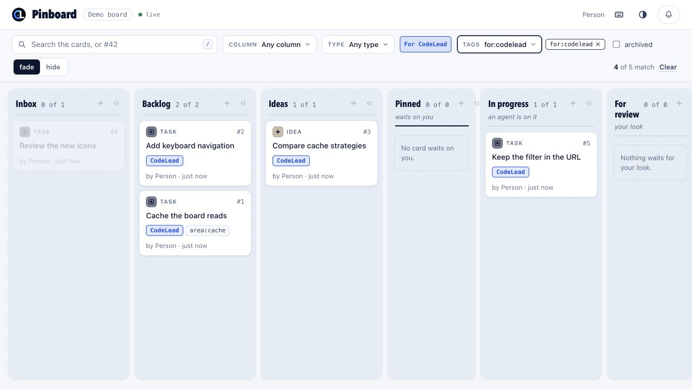

# Work with agents

This page shows how to give the board to a coding agent, such as Claude Code or Codex. It also shows what the agent then does by itself. You set it up once. From then on, the agent checks the board, answers you in the threads, and records its work on the cards.

**In short**
- [`codelead board init`](cli/board-init.md) creates the board and `AGENTS.md`, the guide that teaches an agent the rules. It also prints one paragraph to give to the agent.
- The agent runs [`codelead board check`](cli/board-check.md) at the start of each session, when you ask, and on a timer when it has one.
- The agent proposes cards in Inbox, answers in threads, and moves finished work to **For review** with a `Landed:` comment. You move it to **Done**.
- `new --batch` turns a conversation into several cards at once. `--dry-run` shows them first.

## Before you begin

- CodeLead is installed, and `codelead --version` answers. See [Install CodeLead](../get-started/install.md).
- The repository is a git repository.
- You know the board's ideas: cards, columns and the check. See [Cards, columns and participants](concepts.md).

> [!NOTE]
> **New to this?** An agent has no memory between sessions and no clock. The board gives it both: the cards hold what was said, and the check tells it what changed since it last looked.

## Create the board and name the agents

Run this once, in the repository. Name yourself with `--person` and each agent with `--agent`:

```console
codelead board init --person sam:Sam --agent claude:Claude --agent codex:Codex
```

```output
Board created in docs/codelead/board: board.json, AGENTS.md, events.jsonl, .gitignore, items/, cursors/.
Participants: sam (person), claude (agent), codex (agent). Agents read docs/codelead/board/AGENTS.md.

Tell the agent, once, in the file it reads at the start of every session (CLAUDE.md, a root AGENTS.md or the like):
  This repository has a Pinboard in docs/codelead/board. Read docs/codelead/board/AGENTS.md once per session, take part under your own id (`claude` for Claude, `codex` for Codex), and run `codelead board check --as <you>` at the start of the session and whenever asked; check again every 30 minutes while the session runs where you have a timer (Claude Code: `/loop 30m codelead board check --as <you>`).
Before that file says it, the first session starts with one sentence to the agent: "Read docs/codelead/board/AGENTS.md and check the board under your own id."
CodeLead joined the board as the participant codelead: tag a card for:codelead to hand it to CodeLead (codelead implement --queue takes those, top of Backlog first).
```

Without `--person`, the person is this machine's user name. Without `--agent`, the agent is `claude` ("Claude Code"). You can change the participants later in `board.json`.

## Tell the agent about the board

1. Copy the paragraph that `init` printed into the file that your agent reads at the start of every session: `CLAUDE.md` for Claude Code, or a root `AGENTS.md`.
2. In the agent's first session, before that file says it, type the one sentence that `init` printed:

   ```text
   Read docs/codelead/board/AGENTS.md and check the board under your own id.
   ```

3. Commit the board folder, or let the agent commit it:

   ```console
   git add docs/codelead/board
   git commit -m "board: init"
   ```

The cards, the log and `AGENTS.md` travel with the repository. The cursors, the lock, `private-names.txt` and `.local/` stay on each machine: the board's `.gitignore` lists them.

`AGENTS.md` holds the rest: the files, how to check, how to write, what never to do, and how to record finished work. It is written for an agent that has never seen a board. See [Rules for agents](rules-for-agents.md).

## Let the agent check on an interval

An agent checks when a session starts and when you ask. For a check while the session runs, start the timer that the agent offers. In Claude Code:

```text
/loop 30m codelead board check --as claude
```

The timer ends with the session. Codex and other agents have their own timer, or none. The interval is `check.intervalMinutes` in `board.json`, 30 minutes on a new board. A check with nothing new is one short read:

```output
claude: nothing new since 2026-11-20T06:39:35Z. Next check in 30 minutes.
```

> [!TIP]
> **For experienced users:** a check reads nothing but the files' stamps when nothing changed, and writes nothing without `--ack`. A check every 30 minutes costs almost nothing.

## What the agent does

You do not type these commands. The agent runs them because `AGENTS.md` tells it to. You see the result on the page.

### It proposes cards

A finding, a question or an idea becomes a card in Inbox, tagged `by:<agent>`. On the page, the card has a dashed border and says **proposed** until you touch it:

```console
codelead board new --as claude --type question --title "Must a client see the orders of other clients?" --body "The Orders page lists every order today. @sam, should a client see only their own orders?" --tag area:orders --tag repo:webapp
```

```output
Created #2 (question) in Inbox: Must a client see the orders of other clients?
docs/codelead/board/items/0002-must-a-client-see-the-orders-of-other.md
```

A decision card carries its recommendation in its ask. The agent never answers the decision itself:

```console
codelead board new --as claude --type decision --title "Pick the date format of the orders list" --field ask="Show dates as 2026-11-20 or as 20 Nov 2026? I recommend 2026-11-20: it sorts and it reads the same in every language." --field options='["2026-11-20", "20 Nov 2026"]' --tag repo:webapp
```

### It answers you

The agent answers in the card's thread, and addresses you with `@sam` when it needs you. Your answer that names `@claude` comes first in its next check:

```output
claude: 3 new on 3 cards since the board began (no cursor yet), 1 addressed to you.

Addressed to you (1)

#2 Must a client see the orders of other clients?  (question · Inbox)
  sam · 2026-11-20T06:39:33Z  commented: Only their own orders. @claude, the admin role still sees all of them.
…
```

### It records its work

Work starts when you ask for it in the agent's session, for example "do card 1". The agent then moves the card to **In progress**, also out of **Pinned**, because you asked for it. When the work lands, it writes what landed and hands the card to you, in one step:

```console
codelead board move 1 --to for-review --as claude --comment "Landed: 4f2a9c1 on main; webapp/Controllers/OrdersController.cs, webapp/Views/Orders/Create.cshtml (3 tests)."
```

```output
Moved #1 from In progress to For review, with the comment.
```

A comment whose first line starts with `Landed:` also fills the task's **What landed** field. You read the work, then move the card to **Done**.

## Turn a conversation into cards

Ask the agent: "turn this conversation into cards". `AGENTS.md` tells it to write one card for each decision, task, question or idea, and to show you the list first. The agent writes a markdown file. Each card is a `## <title>` heading, a YAML block and its description:

````markdown
## Keep the product price on each order line

```yaml
key: price
type: task
column: backlog
tags: [area:orders, repo:webapp]
relations:
  - { kind: related, to: 1 }
```

Today an order line reads the product's current price. A price change then changes old orders.

## Should a deleted product keep its old orders?

```yaml
key: deleted
type: question
relations:
  - { kind: related, to: "@price" }
```

A product can be deleted from the Products page. Its orders stay in the database, but the Orders page fails on them.
````

A card of the file relates to another card of the file by its `key` (`"@price"`), and to a card on the board by its number. The agent first shows you what would be created:

```console
codelead board new --as claude --batch cards.md --tag source:conversation --dry-run
```

```output
Would create 2 cards from cards.md; nothing was written:
  #5 (task) in Backlog: Keep the product price on each order line  [area:orders, repo:webapp, source:conversation, by:claude]
      related #1
  #6 (question) in Inbox: Should a deleted product keep its old orders?  [source:conversation, by:claude]
      related #5
Run it again without --dry-run to create them.
```

On your yes, it runs the same command without `--dry-run`. All the cards are created, or none: one bad card refuses the whole file, and the refusal names its heading. See [`codelead board new`](cli/board-new.md).

## Work with more than one agent

Each agent takes part under its own id, with its own cursor:

1. Add each agent to `board.json`, or name it with `--agent` at `init`:

   ```json
   { "id": "codex", "kind": "agent", "name": "Codex" }
   ```

2. Give each agent the paragraph that `init` printed. With several agents, it says "take part under your own id".
3. Each agent checks as itself: `codelead board check --as codex`.

A check lists the events by others, so each agent sees what the other agents wrote. An id that is not in `board.json` is refused:

```output
Refused: "robin" is not a participant of the board (sam, claude, codex, codelead); add it to board.json's participants first. Nothing was written.
```

> [!NOTE]
> **For team leads:** a second person is one more line in `participants`, with `"kind": "person"`. The page always writes as the first person in the list.

## Give a card to CodeLead

CodeLead takes part as the agent `codelead`. You hand a card to it with the tag `for:codelead`. The card keeps its column:

- On the page, open the card and select **Send to CodeLead**.
- With a command: `codelead board set 1 --as sam --tag for:codelead`.



Then run CodeLead on the tagged cards:

- [`codelead implement --queue`](../cli/codelead-implement.md) takes the tagged cards that are not archived and not in In progress, For review or Done. It takes Backlog first, then the other columns in the board's order.
- [`codelead implement --card 1`](../cli/codelead-implement.md) works one card. In a chat session, [`/implement --card 1`](../chat-commands/implement.md) does the same.

CodeLead reads the card as the request: its title, its description, your comments, its related cards and its attachments. It writes `Started:` when it starts, and moves the card to In progress. At the end it writes `Landed:` and moves the card to For review, or writes `Stopped:` with the reason and the options, addressed to you. To run a card again, answer in its thread and move it back to Backlog, still tagged.

The other agents do not add the tag: the commands refuse it, and the agent asks you in the card's thread instead. `AGENTS.md` also asks them not to remove the tag, and not to take the cards that carry it.

## Check that it worked

- The agent's first check prints its cards and ends with `Run again with --ack once these are dealt with.` After `--ack`, a second check says `nothing new`.
- Run [`codelead board validate`](cli/board-validate.md). A good board prints a line such as `The board is valid: 6 cards, 37 events, 2 cursors.`

## Details

- **A new machine.** Cursors do not travel with git. On a new clone, an agent's first check starts from the beginning of the log. It looks from a day instead, then acks: `codelead board check --as claude --since 2026-11-20`, then `codelead board check --as claude --ack`.
- **Agents without CodeLead.** `AGENTS.md` also describes the files, so an agent can read and write them with its own tools. The commands add the checks of [Rules for agents](rules-for-agents.md).
- **The guide's text.** `AGENTS.md` comes from `board.json`: its columns, the agents' columns and the interval. CodeLead adds the section "CodeLead on the board" when the participant `codelead` is on the board.

## See also

- [Rules for agents](rules-for-agents.md)
- [Use the board](use-the-board.md)
- [Board commands](cli/index.md)
- [`codelead board init`](cli/board-init.md), [`codelead board check`](cli/board-check.md), [`codelead board new`](cli/board-new.md)
- [`codelead implement`](../cli/codelead-implement.md)
- [Tutorial: work with agents on the board](../tutorials/work-with-agents-on-the-board.md)
